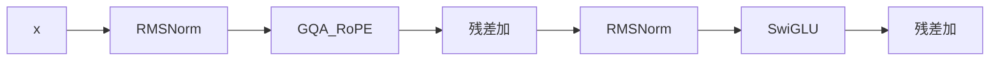

## 要点

**Transformer block** 是解码栈里可重复的一层：pre-RMSNorm → 注意力 → 残差 → pre-RMSNorm → SwiGLU → 残差。残差让你能叠很多层而梯度不至于死掉——进出同形状，才能把同一块重复 `N` 次（Llama 3.2 ~1B 的 **N=16**）。在 arche 里你在 [`block.py`](https://github.com/chaxus/arche/blob/main/arche/block.py) 接好这层「三明治」；每层自有权重，下一章在 stack 里重复它。

### 前向

[`TransformerBlock`](https://github.com/chaxus/arche/blob/main/arche/block.py)：

```python
h, new_cache = self.self_attn(self.input_layernorm(x), cache=cache, start_pos=start_pos)
x = x + h
x = x + self.mlp(self.post_attention_layernorm(x))
return x, new_cache
```



### 残差与 pre-norm

| 选择 | 意义 |
| --- | --- |
| 残差相加 | 梯度高速路；子层≈0 时近恒等 |
| Pre-norm（非 post） | 现代深训稳定 |
| 先 attn 后 MLP | Llama/Qwen 主线（非并行 attn∥MLP） |
| 每层 KV cache | 解码复用该层过去的 K/V |

### 从零搭

| 步骤 | 做什么 |
| --- | --- |
| 1 | 按 config 建 norm、`CausalSelfAttention`、`SwiGLU` |
| 2 | 保持进出 `embed_dim` |
| 3 | 贯通 `cache` / `start_pos` 供生成 |
| 4 | 在 stack 里重复 `N` 次 |

### 自己核对

| 必须成立 | |
| --- | --- |
| 残差是加；pre-norm 位置对；形状 `(B,T,D)` | |
| 每层 cache 独立 | |
| 尽量做到 | 深栈仍能训 / 加载且无 NaN |

### 对整模的杠杆

| 杠杆 | 影响 |
| --- | --- |
| 更大 `N` | 能力与成本 |
| Post → pre-norm | 从零深训成为可能 |
| 换内脏（MLA/MoE） | 前沿变体；block 边界仍在 |

### 本课

```bash
python chapters/01-inference/ep08_block.py
```

## 动手

```bash
python chapters/01-inference/ep08_block.py
```

## 下一章

**整网 + LM head**（`/cn/stack/`）。
