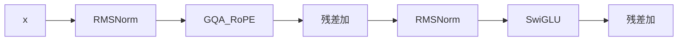

## 要点

**是什么（What）：** 一层可重复的 **Transformer block**——pre-RMSNorm → 注意力 → 残差 → pre-RMSNorm → SwiGLU → 残差。

**为什么（Why）：** 积木只有配上**残差**才能堆成深网。进出同形状，才能叠 `N` 次（Llama 3.2 ~1B：**N=16**）。

**怎么做（How）：** 三明治接一次；每层自有权重；再堆叠训或加载。

### 1. What — 前向

[`TransformerBlock`](https://github.com/chaxus/arche/blob/main/arche/block.py)：

```python
h, new_cache = self.self_attn(self.input_layernorm(x), cache=cache, start_pos=start_pos)
x = x + h
x = x + self.mlp(self.post_attention_layernorm(x))
return x, new_cache
```



### 2. Why — 残差 + pre-norm

| 选择 | 原因 |
| --- | --- |
| 残差相加 | 梯度高速路；子层≈0 时近恒等 |
| Pre-norm（非 post） | 现代深训稳定 |
| 先 attn 后 MLP | Llama/Qwen 主线（非并行 attn∥MLP） |
| 每层 KV cache | 解码复用该层过去的 K/V |

### 3. How — 从零

| 步骤 | 做什么 |
| --- | --- |
| 1 | 按 config 建 norm、`CausalSelfAttention`、`SwiGLU` |
| 2 | 保持进出 `embed_dim` |
| 3 | 贯通 `cache` / `start_pos` 供生成 |
| 4 | 在 stack 里重复 `N` 次 |

### 4. 怎么样算好

| 类型 | 标准 |
| --- | --- |
| **硬** | 残差是加；pre-norm 位置对；形状 `(B,T,D)` |
| **硬** | 每层 cache 独立 |
| **软** | 深栈仍能训 / 加载且无 NaN |

### 5. 如何改进 · 对整模影响

| 杠杆 | 影响 |
| --- | --- |
| 更大 `N` | 能力与成本 |
| Post → pre-norm | 从零深训成为可能 |
| 换内脏（MLA/MoE） | 前沿变体；block 边界仍在 |

### 6. 本课

```bash
python chapters/01-inference/ep08_block.py
```

## 动手

```bash
python chapters/01-inference/ep08_block.py
```

## 下一章

**整网 + LM head**（`/cn/stack/`）。
