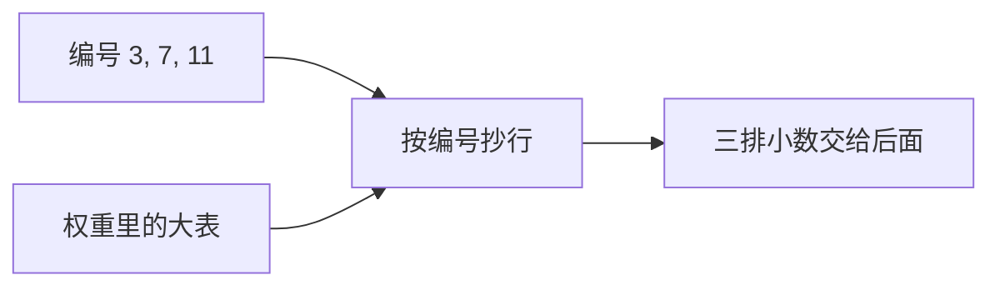

## 要点

### 1. 为什么需要这一步

上一章结束后，句子已经变成一串编号，比如 `[3, 7, 11]`。

问题是：后面的层要做的是乘加、注意力这类运算，**编号本身没法当原材料**。把 `3` 和 `7` 加出 `10`，跟这句话说了什么毫无关系。模型需要的是一串可以参与计算的小数。

所以权重文件里备着一张大表：每个可能出现的编号占一行，每行写着同样长度的小数。嵌入要做的，就是按手里的编号把对应的行抄出来。

### 2. 嵌入到底在干什么

还是用 `[3, 7, 11]` 举例（表里的数是假的，只为看清动作）：

| 编号 | 这一行存的小数 |
| --- | --- |
| **3** | **0.55, -0.17, 0.09, 0.22** |
| **7** | **0.03, 0.41, -0.28, 0.10** |
| **11** | **-0.12, 0.08, 0.33, -0.05** |

看到 `3` 就抄第 3 行，看到 `7` 就抄第 7 行，看到 `11` 就抄第 11 行。抄完得到三排小数。这里没有「理解句子」，也没有查词典——**整步工作就是按编号抄行**。

本页上方的小表就是同一件事：输入 `3, 7, 11`，高亮的就是会被抄走的行。

几个人容易卡住的词，顺带说清：

- **向量**：就是「这一排小数」的别名，没有额外含义。  
- **固定长度**：每一行都一样长。教学表是 4 个小数，Llama 3.2 1B 是 **2048** 个。长度统一，后面才能用同一套公式处理每一个 token。  
- **后面只吃这些**：过了嵌入，后面层既看不见原文，也看不见 `3 / 7 / 11`，只拿到这三排小数继续算。

可以把它想成通讯录或条码：学号对上成绩单的那一行，条码对上价签上的数字。嵌入不是一种聪明算法，就是这张查表。



### 3. 和分词、权重的关系

分词负责「文字 ↔ 编号」，嵌入负责「编号 ↔ 表里的那一行」。表里的小数本身就是权重的一部分，存在检查点里。

因此两张表必须是一对。训练时如果 `the` 一直对应 id `65`，第 65 行就会被调成配合它用的那串数；换了别家分词，`the` 变成 `902`，模型仍去抄第 902 行，结果就会乱——这就是上一章说的配对。

刚初始化或本课的假表里，小数几乎是随机的，**还不表示语义**；意义是后面训练慢慢写进这些数字里的。

### 4. 常见设计差异

老一些的模型会在抄出来的行上再加一张「位置表」（第几个位置各学一串数）。Llama 风格的 dense 解码器一般**不在这里加位置**，把「排在第几」留给后面的 **RoPE**。小 Llama 还常把这张嵌入表和最后给词表打分的层绑在一起用，省一份参数。

本章只关心「这个 token 是谁、该抄哪一行」；位置是下一几章的事。

### 5. 业界实际

Llama 3.2、Qwen 一类都是：嵌入 = 查表，不加绝对位置，小模型常绑 LM head。各厂差在有多少行、每行多长、绑不绑权——**按 id 抄行**这一点几乎不变。

### 6. 怎样算对 · 本课怎么做

进来 `T` 个 id，出去就应该是 `T` 行、每行 `dim` 个小数；第 `i` 行必须对应分词器的 id `i`；若后面走 RoPE，这里就不要再偷偷加回位置表。

`arche/` 里的 `TokenEmbedding` 用很小的假词表演示，免下载。真 Llama 大约十二万行，动作相同，只是表更大。

## 动手

```bash
python chapters/01-inference/ep03_embedding.py
```

预期：看到真实词表大小和演示词表的对比、每行有多长，以及 ids / 输出形状。

## 下一章

**RMSNorm**（`?c=rmsnorm`）：这几排小数进重层之前，先把尺度稳住。
