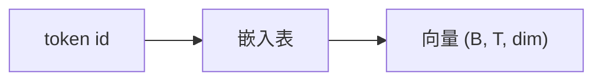

## 要点

### 1. 为什么要嵌入

token id 只是整数。网络要能做乘加，需要每个 id 对应一串数字——**向量**。

### 2. 做什么

**嵌入**是一张查找表，形状 `(词表大小, 维度)`：第 `i` 行是 id `i` 的向量。前向 = 按 id 取行。这里还不「理解」语义，只是符号 → 几何的第一层可学习映射。



### 3. 你会听到的设计

| 选择 | 人话 | 今天 |
| --- | --- | --- |
| 嵌入上再加绝对位置表 | 每个位置学一个向量 | Llama 风格里不作主线 |
| **这里不加位置；RoPE 稍后** | 位置写在 Q/K 上 | **主流 dense** |
| 与 LM head 绑权 | 同一矩阵：id→向量、向量→词表分 | 小 Llama 常见 |

### 4. 业界实际

Llama 3.2 / Qwen 一类：只做查表；**RoPE** 管位置；常 **绑** 嵌入 ↔ LM head。

### 5. 怎样算对

- 形状 `(B, T) → (B, T, dim)`  
- 与分词器同一词表（第 `i` 行 ↔ id `i`）  
- 若后面假定 RoPE，就别在这里偷偷加回绝对 PE  

### 6. 本课怎么做

`arche/` 里的 `TokenEmbedding`。实验用很小假词表，免下载；形状与真模型一致。

## 动手

```bash
python chapters/01-inference/ep03_embedding.py
```

预期：ids / 输出形状，并提醒位置交给 RoPE。

## 下一章

**RMSNorm**（`?c=rmsnorm`）：进重层前先稳住尺度。
