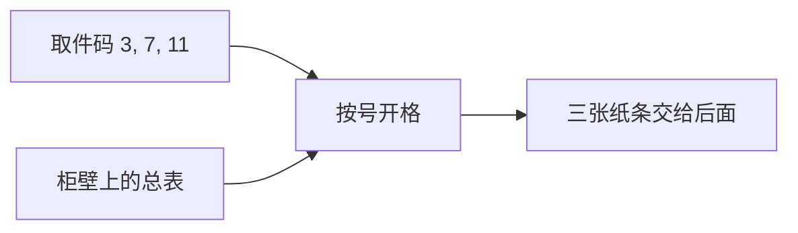

## 要点

### 1. 卡在哪一句？拆开看

先别管「权重文件」「向量」这些词。只记住一个生活画面：

**快递柜。**

- 柜子有很多格，格子上写着号码：`0、1、2、3…`  
- 每个格子里事先放好一张纸条，纸条上写着几个小数  
- 你手里有一张取件码：`3, 7, 11`  
- 你做的事：打开 3 号格，取出纸条；打开 7 号格，取出纸条；打开 11 号格，取出纸条  

**嵌入 = 按号码开柜取纸条。**  
没有理解句子，没有思考，就是「号码对上哪一格，就把那一格里的东西拿出来」。

模型里的那张「柜壁上的总表」，平时存在下载下来的模型文件里；大家说「权重」时，表里这些小数也算其中一部分。先把它想成**已经印好的柜格内容**就行。

### 2. 用数字走一遍

假设柜壁上只有这几格（数是假的）：

| 格号 | 格子里的纸条 |
| --- | --- |
| 3 | `0.55, -0.17, 0.09, 0.22` |
| 7 | `0.03, 0.41, -0.28, 0.10` |
| 11 | `-0.12, 0.08, 0.33, -0.05` |

分词给了你取件码 `[3, 7, 11]`。嵌入之后你手里变成：

```
第 1 张纸条：0.55, -0.17, 0.09, 0.22   ← 从 3 号格取出
第 2 张纸条：0.03, 0.41, -0.28, 0.10    ← 从 7 号格取出
第 3 张纸条：-0.12, 0.08, 0.33, -0.05   ← 从 11 号格取出
```

**之前：** 只有三个整数 `3, 7, 11`（没法拿去认真做乘加）。  
**之后：** 三张纸条上的小数（后面的层只拿这些小数继续算）。

本页上方的小表就是这个快递柜：输入 `3, 7, 11`，高亮的格就是你会打开的格，下面列出取出的纸条。

为什么每张纸条一样长？因为后面要用同一套公式处理每一个 token——教学柜每张 4 个数，真 Llama 3.2 1B 每张 **2048** 个数。别人说「向量」，指的就是这张纸条，没有更多意思。



### 3. 和分词、权重的关系

分词：文字 → 取件码（编号）。  
嵌入：取件码 → 打开对应格、取出纸条。  
权重：柜格里那些小数；模型文件里存着整面柜壁。

两套必须配对：训练时 `the` 一直用 65 号格，65 号里的数就会被调成配合它的；你却拿别家的取件规则把 `the` 编成 902，模型仍去开 902 号格 → 拿错纸条。

假表或刚初始化时，纸条上几乎是随机数，**还不表示语义**；训练才会慢慢改这些数。

### 4. 常见设计差异

老模型有时还会再加一张「位置柜」（第几个词各学一串数，加到纸条上）。Llama 风格一般**在这里不加位置**，把「排第几」留给后面的 **RoPE**。小 Llama 常把这面柜壁和最后给词表打分的层共用，省一份存储。

本章只问「开哪一格」；位置是后面的事。

### 5. 业界实际

Llama 3.2、Qwen 都是：嵌入 = 按号取格；这里不加绝对位置；小模型常绑 LM head。各厂差在有多少格、每张纸条多长、绑不绑——**按号取格**不变。

### 6. 怎样算对 · 本课怎么做

`T` 个编号进来 → 取出 `T` 张一样长的纸条；第 `i` 号格必须对应分词器的 id `i`；后面用 RoPE 就别在这里再加位置表。

`arche/` 的 `TokenEmbedding` 用很小的假柜演示，免下载。真 Llama 大约十二万格，动作相同。

## 动手

```bash
python chapters/01-inference/ep03_embedding.py
```

预期：真实柜格数量 vs 演示柜、每张纸条多长、输入编号 / 输出形状。

## 下一章

**RMSNorm**（`?c=rmsnorm`）：纸条上的数进重层前，先把尺度稳住。
