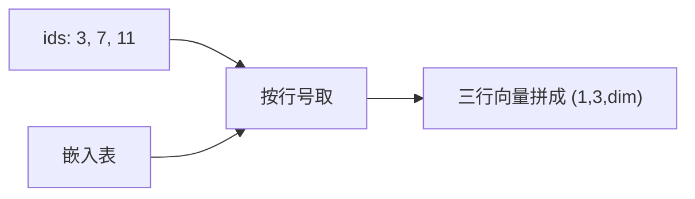

## 要点

### 1. 为什么要嵌入

上一章结束时，句子已经变成一串 **token id**，例如 `[3, 7, 11]`。

id 只是编号：像「第 3 号柜子」「第 7 号柜子」。网络要做的是乘加、注意力——它需要的是**一串可算的小数**，不是柜子号本身。

**嵌入**就是：给每个 id 配上一串固定长度的数字（**向量**），后面整条模型只吃这些向量。

一句话：**分词给出编号；嵌入把编号换成可计算的行。**

### 2. 嵌入做什么（就是查表）

把嵌入想成一张 Excel：

| id（行号） | 第 0 维 | 第 1 维 | 第 2 维 | … |
| --- | --- | --- | --- | --- |
| 0 | 0.12 | -0.04 | 0.31 | … |
| 1 | -0.22 | 0.08 | 0.01 | … |
| 3 | **0.55** | **-0.17** | **0.09** | … |
| 7 | **0.03** | **0.41** | **-0.28** | … |
| … | … | … | … | … |

- 表有 **词表大小** 行（每个可能的 id 一行）  
- 每行有 **维度** 个小数（Llama 3.2 1B 是 2048）  
- 前向几乎不做「聪明计算」：**按 id 把对应行取出来排成序列**

例子：输入 ids = `[3, 7, 11]` → 输出形状 `(1, 3, 维度)`，内容就是第 3、7、11 行拼在一起。



本页上方可先玩**教学小表**（点 id 看取哪几行）；下方脚本用同样思路，假词表免下载。

### 3. 和分词、权重怎么绑在一起

| 概念 | 人话 |
| --- | --- |
| **分词表** | 文字 ↔ id（上一章） |
| **嵌入表** | id ↔ 那一行数字 |
| **权重** | 嵌入表里的数字是训练学出来的，存在检查点里 |

所以：**同一套分词 + 同一套嵌入**才对得上。  
训练时若 `the` → id `65`，第 65 行就被学成「the 的样子」。换了别家分词，`the` 变成 `902`，模型仍读第 902 行 → 乱（上一章配对故事在这里落地）。

刚初始化或本课假表时，数字几乎是随机的——**还不「理解」语义**；语义是后面层层训出来的。嵌入只是符号进几何的**第一层可学习映射**。

### 4. 你会听到的设计

| 选择 | 人话 | 今天 |
| --- | --- | --- |
| 嵌入上再加**绝对位置表** | 第 0 个位置、第 1 个位置各学一个向量，加到 token 向量上 | 老栈常见；Llama 风格**不作主线** |
| **这里不加位置；RoPE 稍后** | 位置写进注意力里的 Q/K 旋转 | **主流 dense 解码器** |
| **与 LM 头绑权** | 进模型用的嵌入矩阵，出词表打分时复用同一张 | 小 Llama 常见，省参数 |

容易混的一点：「位置信息」**不是**嵌入章的主菜。本课表只负责「这个 token 是谁」；「它在第几位」留给后面的 **RoPE**。

### 5. 业界实际

Llama 3.2 / Qwen 一类 dense：

- 嵌入 = **查表**（`nn.Embedding` / 等价物）  
- **不做**嵌入上的绝对位置加和  
- 小模型常 **tie**：嵌入 ↔ 最后一层 LM head  

各厂差异主要在词表大小、维度、是否绑权；「id → 取行」这件事几乎一样。

### 6. 怎样算对 · 本课怎么做

| 标准 | 人话 |
| --- | --- |
| 形状 | `(B, T)` 的 id → `(B, T, dim)` 的向量 |
| 配对 | 第 `i` 行 ↔ 分词器的 id `i` |
| 位置 | 若后面用 RoPE，这里就别偷偷加回绝对 PE |

`arche/` 里的 `TokenEmbedding`。实验用很小假词表（如 32 行），**免下真权重**；真实 Llama 词表约 12 万行，形状逻辑相同。跑脚本时请对一下：ids 形状、输出形状、以及「位置交给 RoPE」那句提示。

## 动手

```bash
python chapters/01-inference/ep03_embedding.py
```

预期：打印真实词表大小 vs 演示词表、`embed_dim`、ids / 输出形状。

## 下一章

**RMSNorm**（`?c=rmsnorm`）：进重层前先稳住尺度，避免数飙掉。
