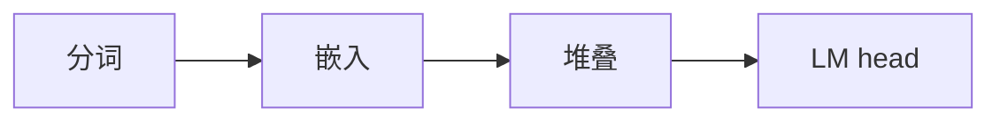

## 要点

### 1. 为什么选这个标本

需要一个够小、开放、像生产的模型，端到端手写。

### 2. 「模型」在这里指什么

**Llama 3.2 风格**的 next-token 栈：分词 → 嵌入 → 块堆叠 → LM head。人们常叫它 **dense 解码器**——名字后面混熟即可。



### 3–5. 为什么是 Llama 3.2

约 1B、权重可下、积木与很多生产 dense 一致（RMSNorm、RoPE、SwiGLU、GQA）。后面还有推理、小训练、前沿引物。

### 6. 本课怎么做

实验打印配置尺寸——还不是聊天。

## 动手

```bash
python chapters/01-inference/ep01_overview.py
```

## 下一章

**分词器**（`?c=tokenizer`）。
