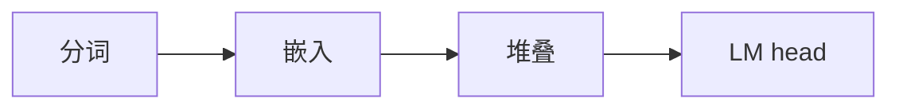

## 要点

### 1. 有什么作用

这一章定标本：**Llama 3.2 风格**的 next-token 栈——分词 → 嵌入 → 块堆叠 → LM head。人们常叫它 **dense 解码器**。后面所有章都挂在这条主干上。



### 2. 为什么课程过程需要它

学大模型需要一个够小、开放、又像生产的模型，才能端到端手写。没有统一标本，后面的 RMSNorm、RoPE、GQA 会对不上同一套配置。

### 3. 怎么来的 · 怎么选

| 考量 | Llama 3.2 1B |
| --- | --- |
| 体量 | 约 1B，笔记本可碰 |
| 开放 | 权重可申请下载 |
| 积木 | RMSNorm、RoPE、SwiGLU、GQA——与很多生产 dense 一致 |
| 课程序列 | 先主干，再推理优化、小训练、前沿引物 |

### 4. 有什么标准 · 怎样算「选对了」

| 类型 | 标准 | 人话 |
| --- | --- | --- |
| **硬** | 配置尺寸能打印、自洽 | 词表、层数、维度对得上文档 |
| **软** | 能支撑整门课 | 后面章都能挂上，而不是只讲玩具公式 |
| **软** | 诚实边界 | 本课 dense 主干 + 引物，不是完整 vLLM / 全量预训练 |

### 5. 本课怎么做

实验打印配置尺寸——还不是聊天。

## 动手

```bash
python chapters/01-inference/ep01_overview.py
```

## 下一章

**分词器**（`?c=tokenizer`）。
