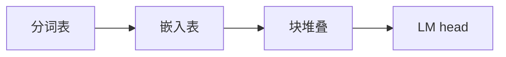

## 要点

本课是**从零训到能对接业界前沿**：先选一个与生产同构的标本，再逐块手写、再谈加速与训练。标本错了，后面所有「业界怎么做」都会对不上。

### 1. 有什么作用

定标本：**Llama 3.2 风格** next-token 栈——分词 → 嵌入 → 块×N → LM head（**dense 解码器**）。后续章都挂在这条主干上。



### 2. 从零开始：怎么「生成」这条路线

| 步骤 | 做什么 |
| --- | --- |
| **1. 选开放、可下、够小的生产同构模型** | 本课：Llama 3.2 ~1B |
| **2. 冻结其分词 / 记下 V、D、层数、头数** | 配置即契约 |
| **3. 按同积木手写模块** | RMSNorm、RoPE、GQA、SwiGLU… |
| **4. 先随机权重跑通形状，再加载/自训权重** | 图对 → 数对 |
| **5. 再叠推理与对齐** | KV、批处理、SFT… |

### 3. 怎么样算选对了

| 类型 | 标准 |
| --- | --- |
| **硬** | 配置自洽；积木与声称的开源配方一致 |
| **硬** | 能支撑「从零」叙事：表可训、网可叠、权可装 |
| **软** | 社区文档全、权重可申请 |
| **软** | 后续前沿引物（MoE/MLA）有地方挂 |

### 4. 如何改进 · 对整模影响

换标本（如改 Qwen）→ 分词/嵌入/块配置全换，课程映射要重做。加深/加宽 → 全面重训。本课保持 1B 标本，用引物看更大模型。

### 5. 业界 · 开源怎么做

Llama / Qwen / DeepSeek 等均以「公开配置 + 检查点 + 分词」发布；教学与复现都先对齐一份配方。vLLM 等引擎假设你已有这类 dense/MoE 检查点。

### 6. 本课

```bash
python chapters/01-inference/ep01_overview.py
```

打印配置尺寸，还不是聊天。

## 动手

```bash
python chapters/01-inference/ep01_overview.py
```

## 下一章

**分词器**（`?c=tokenizer`）：从零生成分词表。
