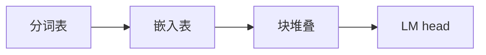

## 要点

本课是**一条从零到对接业界前沿**的路。阅读顺序：写出 dense 本体 → **从零训练写出权重** → 服务加速 → 前沿结构（MoE/MLA）。贯穿例子是 **Llama 3.2 ~1B**——例子配方错了，后面「业界怎么做」会对不上。

### 1. 有什么作用

你亲手写出 **Llama 3.2 风格** next-token 栈——分词 → 嵌入 → 块×N → LM head（**dense 解码器**）。后续章都挂在同一条主干上。官方 Llama 文件是这个例子的成品一对，不是第二条课。



### 2. 为什么用 Llama 3.2 ~1B 当例子

**一句话：学当前前沿 dense 架构，用你能跑完的规模。**

Llama 3.2 是 Meta **Llama 3** 系列的开放小规格——与更大 Llama（以及 Qwen 一类 dense）同属一套配方：**RMSNorm + RoPE + GQA + SwiGLU + 字节级 BPE**。这是今天开源 dense 主干的主流积木，不是为课堂简化的玩具网。MoE / MLA、更大引擎放在后面，作为挂在这条主干上的引物。

| 为什么选它 | 人话 |
| --- | --- |
| **前沿同构的积木** | 模块名与契约，和当前开源 dense / 推理栈对得上 |
| **同一家族、可学规模** | ~1B 让 V / D / 层数 / 头数可数、HF 可下——架构仍是 Llama 3，尺寸是为了学得完 |
| **开放成品一对** | 官方分词 + 检查点，「手写 vs 业界」才是真对照 |
| **先 dense** | 先拿下 dense 解码器，再摸 MoE/MLA；不从 GPT-2 博物馆起步 |

所以：**架构 = 当前前沿 dense；规模 = ~1B，好让从零写得完。** 不是「聊天最强」，也不是「在家训 70B」。

### 3. 从零开始：怎么「生成」这条路线

| 步骤 | 做什么 |
| --- | --- |
| **1. 钉死例子** | Llama 3.2 ~1B |
| **2. 学会这类分词/嵌入表怎么生成** | 教学 BPE + 玩具嵌入；记下 V、D、层数、头数 |
| **3. 按同积木手写模块** | RMSNorm、RoPE、GQA、SwiGLU… |
| **4. 先随机权重跑通形状，再 Part 2 自训，并可用 Llama 例子加载对照** | 图对 → 数对 |
| **5. 生成 + HF 验收 → 服务 → 前沿** | 侧栏一条路 |

### 4. 怎么样算选对了

| 类型 | 标准 |
| --- | --- |
| **硬** | 配置自洽；积木与声称的开源配方一致 |
| **硬** | 能支撑「从零」叙事：表可训、网可叠、权可装 |
| **软** | 社区文档全、权重可申请 |
| **软** | 后续前沿引物（MoE/MLA）有地方挂 |

### 5. 如何改进 · 对整模影响

换例子（如改 Qwen）→ 分词/嵌入/块配置全换，课程映射要重做。加深/加宽 → 全面重训。本课保持 1B 例子，用引物看更大模型。

### 6. 业界 · 开源怎么做

Llama / Qwen / DeepSeek 等均以「公开配置 + 检查点 + 分词」发布；教学与复现都先对齐一份配方。vLLM 等引擎假设你已有这类 dense/MoE 检查点。

### 7. 本课

```bash
python chapters/01-inference/ep01_overview.py
```

打印配置尺寸，还不是聊天。

## 动手

```bash
python chapters/01-inference/ep01_overview.py
```

## 下一章

**分词器**（`/cn/tokenizer/`）：从零生成分词表。
