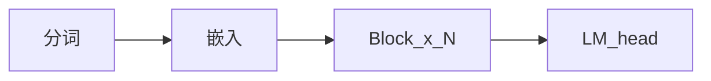

## 一句话
先看清现代 dense 语言模型的全貌——以及为什么本课不从 GPT-2 考古开始。

## 开始之前
- 第 0 部分（尤其是旅程地图）已完成。
- 约 12 分钟。
- 读完可跑配套脚本。

## 用人话讲
**Dense 解码器**从左到右读 token，预测下一个。内部是同一种积木重复很多层。现代做法更偏向：

- **RMSNorm** 稳住数值
- **RoPE** 用旋转表达位置
- **SwiGLU** 作为前馈网络配方
- **GQA** 让解码时的 KV 更省

**Llama 3.2 谱系**就是按这张零件清单走（教学目标是 1B）。能力以后来自官方权重；理解来自自己写前向。



## 图或公式
先记住上面的流程图；公式会在需要时出现。

## 对应代码
- 配置：`arche/config.py`（`llama32_1b`）
- 配套：`chapters/01-inference/ep01_overview.py` 打印层数、头数、维度——不是聊天。

## 现在就做
```bash
python chapters/01-inference/ep01_overview.py
```
应看到词表大小、层数、头数等数字。

## 如果翻车了
- `No module named arche`：激活 `.venv`，在仓库根目录运行。
- 找不到脚本：先 `cd` 到 `arche` 目录。

## 先别深挖
训练超大模型、线上服务、所有 Llama 变体。

## 下一章
**分词器**（`?c=tokenizer`）。
