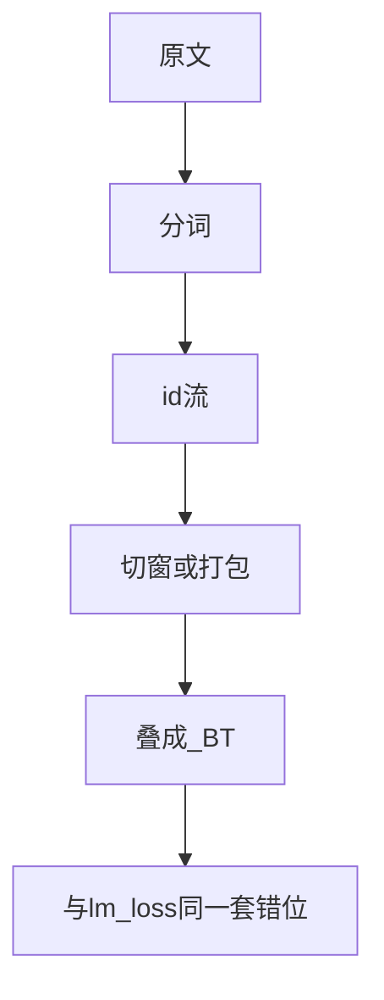

## 要点

预训练要把原文变成损失能吃的 **`(batch, time)` id 张量**。路径是：文档 → 分词 → 切窗或打包 → 组 batch →（可选）pad / mask。上一章的目标不变；**数据形状**决定每步看见什么信号。窗切错——把 pad 当标签、漏未来、乱拼接——会静默浪费或训歪。无论 shift 写在 collator 还是模型里，**labels 的错位规则必须与 `lm_loss` 一致**。

### batch 里有什么

| 零件 | 作用 |
| --- | --- |
| **文档** | 原文（网页、书、代码…） |
| **token ids** | 分词器输出（BPE 等） |
| **窗 / block** | 模型一次看见的长度 `T`（上下文） |
| **batch** | `B` 个窗叠成 `(B, T)` |
| **labels** | 同一串 ids，按 shift（或 HF 内部 shift）解释 |

两种常见布局：

| 布局 | 想法 |
| --- | --- |
| **滑窗 / 切块** | 长 id 流切成不重叠或步长 `T` 的块（nanoGPT 风格） |
| **打包 packing** | 多篇短文拼进一条，用分隔/注意力边界，GPU 更满 |

### 设计时要注意什么

| 压力 | 后果 |
| --- | --- |
| GPU 喜欢密实 `(B,T)` | 倾向 packing，而不是碎短序列 |
| 上下文 `T` | 限制「下一个 token」能回看多远 |
| pad | **不能**当真词来训（mask 或 ignore_index） |
| 文档边界 | 盲拼接会跨无关文档造假「下一词」，除非 mask |

### 本仓库的玩具窗

实验 batch 是随机 id，教**回路**，不是真语料：

```python
batch = torch.randint(0, V, (B, T))
logits, _ = model(batch)
loss = lm_loss(logits, batch)  # 用 batch[:, 1:] 作目标
```

生产草图（概念，类 nanoGPT）：

```python
# tokens: 一维长 id 流
ix = torch.randint(0, len(tokens) - T, (B,))
x = torch.stack([tokens[i : i + T] for i in ix])
y = torch.stack([tokens[i + 1 : i + T + 1] for i in ix])
# 再 CE(model(x), y) —— y 已错位；不要再 shift
```

**HF：** collator 若 `labels == input_ids`，**模型内部** shift；若你自己造 `y`，CE **不要**再 shift。



### 自己核对

- 每个监督位置有真下一 id，或已被 mask。
- label / 输入错位与损失实现一致，没有 shift 两次。
- token 利用率高（少纯 padding）。
- 领域混合覆盖你关心的场景。

### 对整模的影响

| 杠杆 | 影响 |
| --- | --- |
| 更干净/更多 token | 底座更强 |
| 更长 `T` | 长程猜词更好（成本↑） |
| packing 质量 | 吞吐与每天有效更新 |
| 领域配比 | 模型「流利」在哪些域 |

### 本课

暂无同一脚本：

```bash
python chapters/02-training/ep18_pretrain.py
```

把随机 batch 当成「假窗」。真 DataLoader 离开玩具脊柱后再接。

## 动手

```bash
python chapters/02-training/ep18_pretrain.py
```

## 下一章

**预训练优化**（`/cn/pretrain-optim/`）：AdamW、学习率、梯度裁剪、累积。
