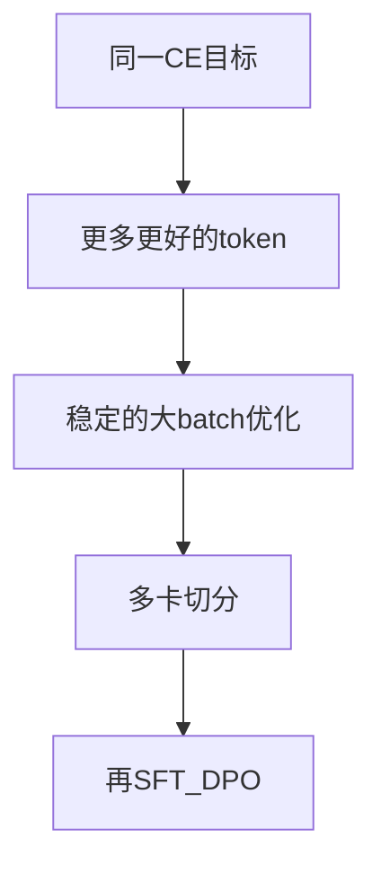

## 要点

**是什么（What）：** 把同一条 next-token 环**放大**的入门图——更多 token、分阶段、并行——先不离开初学者脊柱去做完整系统课。

**为什么（Why）：** Llama 3.2 ~1B 与前沿大跑共享 **目标 + 一步**；差别在 **数据量、分阶段菜谱、集群账、以及（有时）结构**（稠密 vs MoE）。有这张地图，才不会「玩具 loss 降了就毕业」。

**怎么做（How）：** 把公开菜谱读成你已有章节的*扩展*：还是 CE，更难的是数据 / 优化 / 工程。

### 1. What — 放大的轴

| 轴 | 玩具（本课） | 前沿形态 |
| --- | --- | --- |
| **Tokens** | 几个随机 batch | 万亿级真 token |
| **步数 / 阶段** | 一条平坦环 | 多段 lr、数据配比、加长上下文 |
| **Batch** | 很小的 `B,T` | 累积 + 数据并行撑起巨大有效 batch |
| **模型** | 极小稠密 `Llama` | 稠密 1B–70B+ 或 MoE（DeepSeek）+ MLA |
| **硬件** | 单进程 | Megatron/FSDP/流水线式切分 |

Llama 3 类公开报告：长 pretrain + 短高质量 anneal / 长上下文阶段——心里仍是 next-token。

DeepSeek-V2/V3：**同一族因果 LM**，不同的是**块**（MLA + MoE）——见 Frontier；训练仍是 CE + 大数据优化。

### 2. Why — 为什么不能停在 ep18

| 错觉 | 现实 |
| --- | --- |
| 「随机 id 上 loss 降了」 | 只证明**回路**，不是语言能力 |
| 「抄 AdamW 默认就行」 | 放大后要 warmup/日程/clip |
| 「只把模型变大」 | 数据质量 × token 量往往更关键 |
| 「SFT 能救烂底座」 | 对齐改风格；弱 pretrain 仍然弱 |

### 3. How — 四行读懂一篇菜谱

打开 Llama / DeepSeek / Megatron 文时，对照：

1. **目标** → 仍是 next-token CE（预训练）  
2. **数据** → 配比、packing、上下文日程（预训练数据）  
3. **优化** → AdamW、lr 形状、clip、有效 batch（预训练优化）  
4. **系统** → 并行、精度、checkpoint（更后 / 运维）



### 4. 怎么样算好（初学者条）

| 类型 | 标准 |
| --- | --- |
| **硬** | 能指出论文动的是哪一根轴 |
| **软** | 不把 MoE**结构**误当成另一种**损失** |
| **软** | 知道「复现 Llama」前还有工程章 |

### 5. 如何改进 · 对整模影响

| 杠杆 | 影响 |
| --- | --- |
| Token 预算 | 能力主因 |
| 分阶段数据 / LR | 稳定与末期质量 |
| 并行效率 | 预算是否用得起来 |
| 结构（GQA/MoE/MLA） | 每 token 成本与显存——不是新目标 |

### 6. 本课

入口仍是：

```bash
python chapters/02-training/ep18_pretrain.py
```

脊柱下一步：稠密**积木**（RMSNorm→…），让 `model(batch)` 背后的前向不再是黑盒——再 HF 对齐权重，再 **SFT/DPO**。

## 动手

```bash
python chapters/02-training/ep18_pretrain.py
```

## 下一章

**RMSNorm**（`/cn/rmsnorm/`）：你刚在训的那次前向里的第一块积木。
