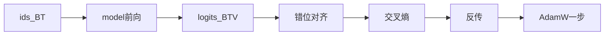

## 要点

**是什么（What）：** *因果语言建模* / **下一个 token 预训练**——只看左边的 token，给词表每个 id 打「下一个是谁」的分，再训练让**真的下一个 id**概率变高。

**为什么（Why）：** 这一个自监督目标，就是**写出**嵌入行和几乎全部主干权重的作者。没有它只有随机空壳（或只能加载别人的小数，如后面的 Llama 例子）。

**怎么做（How，一句话）：** 文本分词 → 嵌入 → 前向 → **错位（shift）**让位置 `t` 预测 id `t+1` → 交叉熵 → 反传 → 优化器一步。在海量语料上重复。

业界同名事物：nanoGPT 的 `X,Y` 窗、Hugging Face「causal LM」、Llama 3 / DeepSeek 的「先 pretrain 再 align」。

### 1. What — 训练目标

对序列 \(x_1,\ldots,x_T\)：

\[
p(x_1,\ldots,x_T)=\prod_t p(x_t \mid x_{<t})
\]

训练最小化平均**负对数似然** = 逐 token **交叉熵**。标签来自文本自己（自监督）。

| 名字 | 含义 |
| --- | --- |
| **logits** | softmax 前的分数，形状 `(batch, time, V)` |
| **next-token CE** | 每个时间步惩罚「真下一 id」概率过低 |
| **因果** | 位置 `t` 不能看见 `t` 之后的 token |

### 2. Why — 为什么要这样设计

| 选择 | 原因 |
| --- | --- |
| 预测**下一个** id | 任意原文都能变成训练信号 |
| 一次前向、多位置监督 | 长 `T` 的序列约贡献 `T-1` 个合法猜题（靠因果 mask） |
| 词表上的 CE | 对应「离散选词」；经 softmax 可反传 |
| 更新**嵌入 + 全部积木** | 嵌入章的小数不是手填的——在这里被改写 |
| 先 pretrain 再 SFT/DPO | 对齐是转向，不是从零发明「会猜词」 |

推理 vs 训练：

| | 推理 | 训练（本章） |
| --- | --- | --- |
| 真下一 id | 不知道 | batch 里已知 |
| logits 之后 | 采样 / argmax | 与真 id 做 CE |
| 权重 | 通常冻住 | 每步更新 |

### 3. How — 错位、损失、一步（仓库真码）

假 ids `[10, 20, 30]`：

| 位置 | 概念上看到的 | 要预测 |
| --- | --- | --- |
| 0 | `10` | `20` |
| 1 | `10,20` | `30` |

**本仓库实现**（[`arche/train/pretrain.py`](https://github.com/chaxus/arche/blob/main/arche/train/pretrain.py)）：

```python
def lm_loss(logits: torch.Tensor, targets: torch.Tensor) -> torch.Tensor:
    """用位置 0..T-1 预测 token t+1。"""
    return F.cross_entropy(
        logits[:, :-1].reshape(-1, logits.size(-1)),  # 去掉最后时刻
        targets[:, 1:].reshape(-1),                   # 去掉第一个 id
    )
```

同一份 `batch` 既当输入，又当标签来源：`logits[t]` 对齐 `targets[t+1]`。

一步：

```python
opt.zero_grad(set_to_none=True)
logits, _ = model(batch)       # (B, T, V)
loss = lm_loss(logits, batch)
loss.backward()
opt.step()
```

实验脚本（[`ep18_pretrain.py`](https://github.com/chaxus/arche/blob/main/chapters/02-training/ep18_pretrain.py)）：玩具 `Llama` + 随机 id batch + `train_pretrain_steps` → 打印 loss 起止。

**HF 坑：** `DataCollatorForLanguageModeling(mlm=False)` 常把 `labels = input_ids` **不预先错位**；Transformers 的 CausalLM 在 `forward` **内部** shift。手写回路（本课 / nanoGPT）是显式 shift。**不要 shift 两次。**



随机初始化时，loss 大约 `log(V)`（均匀猜词表）。

### 4. 怎么样算好

| 类型 | 标准 |
| --- | --- |
| **硬** | 只错一位；因果（不漏未来） |
| **硬** | 梯度打到嵌入行 + 主干；无 NaN |
| **软** | loss 下降；抽样不那么胡说 |
| **软** | 大规模时对齐公开菜谱（后章） |

### 5. 如何改进 · 对整模影响

| 杠杆 | 影响 |
| --- | --- |
| 更多/更好的 token | 能力上限主因 |
| shift / mask 正确 | 错了会静默训歪 |
| lr / 裁剪 / 累积 | 能不能跑完（下一章） |
| 训练不足 | 嵌入**和**深层都弱 |

后面把**数据窗**、**优化器**、**前沿规模菜谱**拆开，本章专注「目标 + 一步」。

### 6. 业界指针

- Raschka：input/target 窗怎么切  
- nanoGPT `train.py`：可读完整环  
- HF LLM Course ch7.6：从零因果 LM  
- Llama 3 / DeepSeek 报告：目标同族，规模与结构不同  

### 7. 本课

```bash
python chapters/02-training/ep18_pretrain.py
```

页内可拖 lr / 步数。前向积木细节在数据/优化引物之后的 RMSNorm→…。

## 动手

```bash
python chapters/02-training/ep18_pretrain.py
```

## 下一章

**预训练数据**（`/cn/pretrain-data/`）：batch 与滑窗怎么来。
