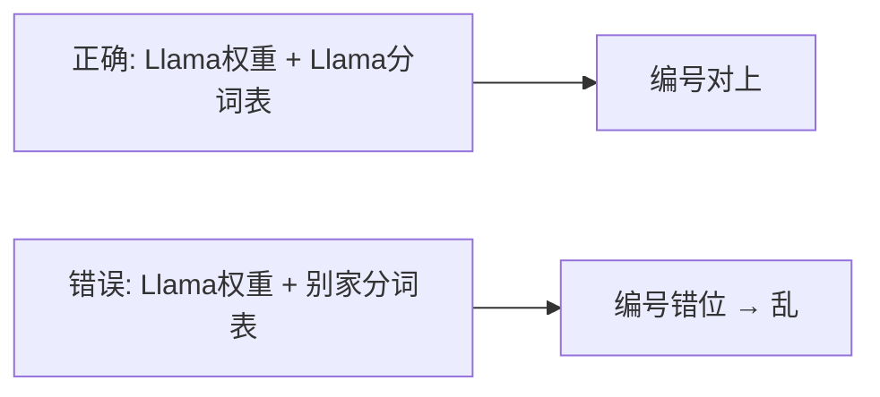

## 要点

### 1. 为什么要分词

模型只会算数字，不会直接读「你好世界」。

- 整句当一个符号 → 词表炸、没见过的话无法表示  
- 拆成纯字节 → 序列太长，又慢又占上下文  

**分词**找中间态：稳定、可学习、长度可控。  
一句话：**同一套规则，进模型前编码，出模型后再解码。**

### 2. 分词器做什么

1. **切** — 文字 → 小段（**token**）  
2. **编号** — 查固定词表 → **token id**（整数）  

之后整条链路只认 id；生成结束用**同一张表**解码。开始/结束等特殊符也是表里的固定 id。


本页上方可先玩**教学小 BPE**（看切法直觉）；下方脚本才用**官方 Llama 3.2 表**。

### 3. 常见切法，以及三个名字

| 切法 | 人话 | 今天 |
| --- | --- | --- |
| 按词 / 空格 | 英文空格切；中文还要另分 | 大模型几乎不作主方案 |
| 按字符 / 字节 | 一字或一字节一个 id | 当保底层；纯用太长 |
| **BPE** | 按频率合并相邻片 | **开放解码器主流** |
| **WordPiece** | 也按子词，合并规则不同 | BERT 一代多 |
| **Unigram**（常经 **SentencePiece** 训） | 从大词表删片 | 多语言/部分栈仍用 |

**BPE**：从字节/字符起，谁俩最常挨着就合并谁，反复合并成词表。常见片段容易变成单独 token（如 `the`、`ing`）。

**WordPiece**：也是子词，但更看「合起来是否提高语料似然」。和 BPE **外表像、规则不同，表不能混用**。

**Unigram / SentencePiece**：Unigram 是「先大后删」的训练目标；SentencePiece 多半是**训/存的工具**（常直接切原文，方便中文）。有人说「SentencePiece 分词」≈ 用该工具训出的 Unigram（或 BPE）。

三者都是**子词**：不像整词那么脆，不像纯字节那么碎。产品差异更常出在**语料、预分词正则、词表大小**。

### 4. 业界实际用啥

| 系 | 引擎 | 约词表 | 备注 |
| --- | --- | --- | --- |
| GPT-4 / 3.5 | tiktoken BPE `cl100k` | ~100K | 切法库开源 |
| GPT-4o / o | tiktoken BPE `o200k` | ~200K | 更大，多语言常更省 |
| Llama 3 / 3.2 | 字节 BPE | 128K+ | **本课官方表** |
| DeepSeek-V3 | 字节 BPE | ~128K | 调预分词/语料做多语言压缩 |
| Kimi K2 | tiktoken 风 BPE | ~163K | 汉字更友好的正则 |
| Qwen 等 | BPE | ~150K | 同路线，表各家自训 |

结论：大家都在 **字节级 BPE / tiktoken 系**里抠细节，不是有的按词、有的按字分家。

### 5. 怎样算「好」（含「权重」是什么）

| 标准 | 人话 |
| --- | --- |
| **压缩 / fertility** | 同样文字几个 token；越少越省。fertility = 平均一词切几片，**越大越碎** |
| **语言公平 / parity** | 中英等同义句 token 数别差太多，否则多语言偏科、更贵 |
| **结构** | 别切坏缩进、换行、URL、数字 |
| **与检查点配对** | 见下例——这是硬约束 |
| **词表大小 / 速度 / 可逆 / 特殊符 / 下游分数** | 越大常越省但嵌入更胖；要快、能还原、标记清晰；最终仍看训完好不好 |

**「必须配对同一套权重」——以及：平时为什么好像不会换表？**

下一章：每个 id 去**嵌入表**取一行数字（这些数是模型**权重**的一部分）。  
正常用法本来就是：**怎么切，就怎么取**——一份检查点配它出厂的那张分词表，你不会中途随便换。

那为什么还强调「换切法会乱」？因为**世界上本来就有很多张表**，乱通常出在**配错对**，不是同一次推理里改主意：

| 何时会「表不一样」 | 例子 |
| --- | --- |
| **换模型家族** | Llama 表 ≠ Qwen 表 ≠ GPT 的 `cl100k` / `o200k` |
| **同厂换代** | GPT-3.5 ~100K → GPT-4o ~200K（为多语言等重训/扩表） |
| **自己从头训** | 按语料新训一张 BPE；旧表装不上新嵌入 |
| **加特殊符** | 微调/工具调用往表尾加标记；合并规则多半不变，id 空间变了 |
| **操作失误** | 权重是 Llama，却加载了别家 `tokenizer.json` |

所以：

- **用同一个模型时**：怎么分就怎么取，不会无故换表。  
- **强调配对**：避免「这份权重 + 那家的分词」；也解释为何各厂表不同、换代会扩表。  

举例：训练时 `the` → **65** → 第 65 行是「the」。若误用另一张表变成 `the` → **902**，模型仍读 902 行 → 乱。



论文口径：压缩、公平**有用但不是唯一分数**；多语言要综合看。

### 6. 本课怎么做

用官方 **Llama 3.2** BPE（`128256`）：不是因为「我们可能换表」，而是**加载这份权重时只能配这张表**。教学面板只演示 BPE 直觉，不替代官方表。

## 动手

先接受 Hugging Face 上 `meta-llama/Llama-3.2-1B` 许可，再：

```bash
huggingface-cli login
python chapters/01-inference/ep02_tokenizer.py
```

预期：token id、解码回原句、bos / eos / pad。大陆网络可：`export HF_ENDPOINT=https://hf-mirror.com`

## 翻车

本章要下门禁分词器，卡住再看：

- 未许可 / 未 login → 看脚本提示  
- `401` → 模型页 Agree 后重新 login  
- 下载慢 → HF 镜像  

## 下一章

**嵌入层**（`?c=embedding`）：id 怎样变成那一行向量。
