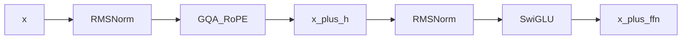

## Idea

**What:** One **Transformer block** — the repeatable layer: pre-RMSNorm → attention → residual → pre-RMSNorm → SwiGLU → residual.

**Why:** Bricks only become a deep net when packaged with **residuals**. Same shape in and out so you can stack `N` times (Llama 3.2 ~1B: **N=16**).

**How:** Wire the sandwich once; each layer gets its own weights; stack and train (or load).

### 1. What — forward

[`TransformerBlock`](https://github.com/chaxus/arche/blob/main/arche/block.py):

```python
h, new_cache = self.self_attn(self.input_layernorm(x), cache=cache, start_pos=start_pos)
x = x + h
x = x + self.mlp(self.post_attention_layernorm(x))
return x, new_cache
```



### 2. Why — residuals + pre-norm

| Choice | Why |
| --- | --- |
| Residual add | Gradient highway; identity path if sublayer ≈0 |
| Pre-norm (not post) | Modern deep training stability |
| Attn then MLP | Llama/Qwen mainline (not parallel attn∥MLP) |
| Per-layer KV cache | Decode reuses past K/V per block |

### 3. How — from zero

| Step | Do |
| --- | --- |
| 1 | Instantiatate norms, `CausalSelfAttention`, `SwiGLU` from config |
| 2 | Keep in/out `embed_dim` |
| 3 | Thread `cache` / `start_pos` for generate |
| 4 | Repeat `N` times in the stack |

### 4. What “good” means

| Kind | Check |
| --- | --- |
| **Hard** | Residuals are adds; pre-norm placement; shape `(B,T,D)` |
| **Hard** | Cache isolated per layer |
| **Soft** | Deep stack still trains / loads without NaNs |

### 5. Improve · whole-model impact

| Lever | Impact |
| --- | --- |
| Larger `N` | Capability and cost |
| Post → pre-norm | Enables deep from-zero training |
| Swap insides (MLA/MoE) | Frontier variants; block boundary stays |

### 6. This course

```bash
python chapters/01-inference/ep08_block.py
```

## Run

```bash
python chapters/01-inference/ep08_block.py
```

## Next

**Stack + LM head** (`/stack/`).
