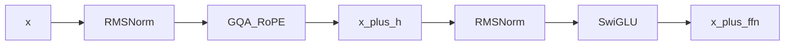

## Idea

One **Transformer block** is the repeatable layer in a decoder stack: pre-RMSNorm → attention → residual → pre-RMSNorm → SwiGLU → residual. Residuals are what let you stack many identical layers without the gradient dying—the input and output stay the same shape so you can repeat the block `N` times (Llama 3.2 ~1B uses **N=16**). In arche you wire this sandwich once in [`block.py`](https://github.com/chaxus/arche/blob/main/arche/block.py); each layer owns its own weights, and the stack chapter repeats the block.

### Forward pass

[`TransformerBlock`](https://github.com/chaxus/arche/blob/main/arche/block.py):

```python
h, new_cache = self.self_attn(self.input_layernorm(x), cache=cache, start_pos=start_pos)
x = x + h
x = x + self.mlp(self.post_attention_layernorm(x))
return x, new_cache
```



### Residuals and pre-norm

| Choice | Why it matters |
| --- | --- |
| Residual add | Gradient highway; identity path if sublayer ≈0 |
| Pre-norm (not post) | Modern deep training stability |
| Attn then MLP | Llama/Qwen mainline (not parallel attn∥MLP) |
| Per-layer KV cache | Decode reuses past K/V per block |

### Build from scratch

| Step | Do |
| --- | --- |
| 1 | Instantiate norms, `CausalSelfAttention`, `SwiGLU` from config |
| 2 | Keep in/out `embed_dim` |
| 3 | Thread `cache` / `start_pos` for generate |
| 4 | Repeat `N` times in the stack |

### Check yourself

| Must hold | |
| --- | --- |
| Residuals are adds; pre-norm placement; shape `(B,T,D)` | |
| Cache isolated per layer | |
| Worth aiming for | Deep stack still trains / loads without NaNs |

### Tuning the whole model

| Lever | Impact |
| --- | --- |
| Larger `N` | Capability and cost |
| Post → pre-norm | Enables deep from-zero training |
| Swap insides (MLA/MoE) | Frontier variants; block boundary stays |

### This course

```bash
python chapters/01-inference/ep08_block.py
```

## Run

```bash
python chapters/01-inference/ep08_block.py
```

## Next

**Stack + LM head** (`/stack/`).
