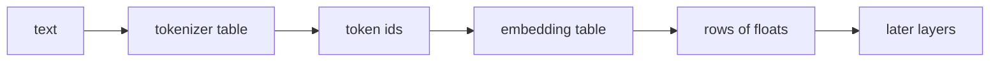

## Idea

### 1. Why embedding

After tokenization you only have ids, e.g. `[3, 7, 11]`.  
Ids are discrete: `3 + 7 = 10` says nothing about the sentence. Later layers need **floats they can multiply and add**.

**Embedding** fills that gap: each id owns a fixed-length row of floats; look up the rows and hand them on.

Locker picture: locker number = id; slip inside = the floats; embedding = open by number. The tiny table above this lesson is that wall.

### 2. What the embedding table is for (vs the tokenizer table)

Two tables, different jobs, usually shipped together and must stay paired:

| | **Tokenizer table** | **Embedding table** |
| --- | --- | --- |
| Maps | text ↔ token id | token id ↔ a row of floats |
| At inference | encode / decode | **gather the row for each id** (usually no updates) |
| Main roles | Chop text into numbered symbols | ① turn discrete ids into computable floats ② store a learnable “face” per id ③ often **share** the same matrix with the final scoring layer on small models |
| Lives in | `tokenizer.json`, etc. | the model **weight checkpoint** (with attention, MLP, …) |
| Who writes it | A tokenizer algorithm (e.g. BPE) on a corpus | **Neural net training** updates the floats |

One-line contrast:

- Tokenizer table: **how to cut and number**  
- Embedding table: **which row of floats each number opens**



Embedding does **not** “understand the sentence”; it only looks up. Meaning is trained into those floats over time.

### 3. How you get an embedding table (vs how you get a tokenizer)

Tokenizer: run BPE (etc.) on a corpus → text↔id rules → save tokenizer files.  
Embedding: **not** another BPE pass, and **not** hand-filled floats. Typical path:

| Step | What happens | Tokenizer analogue |
| --- | --- | --- |
| **1. Shape** | rows = vocab size; width = model dim (e.g. 2048) | pick vocab size |
| **2. Init** | allocate `(vocab, dim)`, fill with **random floats** | before a useful merge table exists |
| **3. Train** | pretrain next-token prediction; gradients **rewrite the embedding (and other layers)** | BPE merges by stats; here the whole net learns together |
| **4. Checkpoint** | write `.safetensors` / `.pth`, etc. | write `tokenizer.json` |
| **5. You use it** | download official weights → **load the trained table**; inference only gathers rows | download official tokenizer → only encode/decode |

Notes:

- **Fine-tuning** may update floats or **append rows** (new special tokens) and train more.  
- **This lesson’s script** builds a tiny **random toy table** so you see gather-by-id—not Llama’s real table.  
- **Real Llama embedding**: inside `Llama-3.2-1B` weights, factory-paired with its tokenizer.

### 4. Design choices you will hear

| Choice | Plain idea | Today |
| --- | --- | --- |
| Absolute PE on embeds | Also learn a row per position | Older stacks; **not** Llama-style main path |
| **No PE here; RoPE later** | Sequence place comes later | **Mainstream dense** |
| **Tied LM head** | Same matrix for gather and vocab scores | Common on small Llamas |

### 5. What labs ship

Llama 3.2 / Qwen: embedding = lookup; no absolute PE here; small models often tie the LM head. Vendors differ on rows, dim, tying—**gather by id** stays.

### 6. What “good” means · what we do

| Check | Plain meaning |
| --- | --- |
| Shape | `T` ids → `T` rows of `dim` floats |
| Pairing | row `i` ↔ tokenizer id `i` (same factory pair) |
| Source | real models: checkpoint table; this lesson: toy table for the action |

`TokenEmbedding` in `arche/`: toy table for gather. Real Llama ~128K rows, same action.

## Run

```bash
python chapters/01-inference/ep03_embedding.py
```

Expect real vs demo vocab size, row length, id/output shapes.

## Next

**RMSNorm** (`?c=rmsnorm`): steady those floats before heavy layers.
