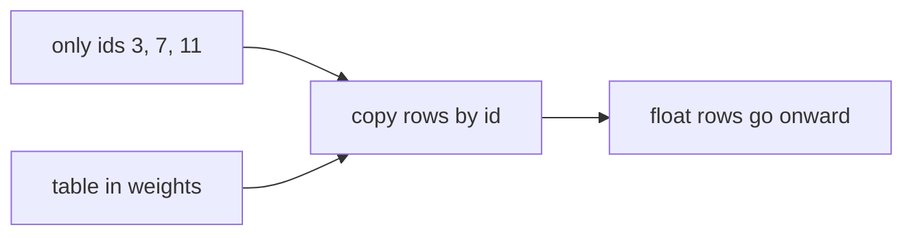

## Idea

### 1. Follow one concrete example

Suppose the tokenizer already gave three ids:

`[3, 7, 11]`

At this point the computer only holds **three integers**.  
You cannot “do attention” on them as language—adding `3 + 7 = 10` has nothing to do with meaning.

So the model keeps a **big table** in the weight file. It looks like this (fake numbers, for teaching):

| id | floats stored on that row |
| --- | --- |
| … | … |
| **3** | **0.55, -0.17, 0.09, 0.22** |
| … | … |
| **7** | **0.03, 0.41, -0.28, 0.10** |
| … | … |
| **11** | **-0.12, 0.08, 0.33, -0.05** |
| … | … |

Embedding does **one** job:

1. See `3` → copy row 3  
2. See `7` → copy row 7  
3. See `11` → copy row 11  

You now have three rows of floats. **No sentence understanding, no dictionary gloss—just copy rows by id.**

The tiny table above this lesson is the same action: type `3, 7, 11` and the highlighted rows are what get copied.

### 2. What that abstract sentence was trying to say

Unpack it; don’t swallow three jargon words at once:

| Phrase | Plain meaning |
| --- | --- |
| “assign each id …” | The table has **one row per id**, written ahead of time (learned in training) |
| “a fixed-length list of numbers” | Every row is the same length. Teaching table: 4 floats; real Llama 3.2 1B: **2048**. Same length ⇒ later layers can use one formula for every token |
| “(a vector)” | Just a name for “that row of floats”—**no extra magic** |
| “the rest of the model only eats these” | After embedding, later layers **never see text or the ids 3/7/11**; they only get those float rows and do multiply-add on them |

So embedding is **not** a clever algorithm. It’s a **phone book**:  
student id → copy that grade row; barcode → copy the price fields.  
Those copied numbers are the raw material for everything after.

One line: **embedding = look up the id, copy the row.**



### 3. How this ties to the tokenizer and weights

| Idea | Plain meaning |
| --- | --- |
| **Tokenizer table** | text → id (previous chapter) |
| **Embedding table** | id → which row of floats |
| **Weights** | the floats themselves; part of the checkpoint |

If training always mapped `the` → id `65`, row 65 was tuned for that.  
A foreign tokenizer that maps `the` → `902` still copies row 902 → garbage. That’s the pairing story from the tokenizer lesson.

Fresh / demo tables look random—**not semantics yet**. Training slowly pushes meaning into those numbers.

### 4. Design choices you will hear

| Choice | Plain idea | Today |
| --- | --- | --- |
| Absolute PE on embeds | Also learn a row per position; add it on | Older stacks; **not** Llama-style main path |
| **No PE here; RoPE later** | “Which place in the sequence” comes later | **Mainstream dense decoders** |
| **Tied LM head** | Reuse the same table when scoring the vocab | Common on small Llamas |

This chapter only asks “which token (which row)”; “which position” waits for **RoPE**.

### 5. What labs ship

Llama 3.2 / Qwen-style: embedding is lookup; no absolute PE here; small models often tie this table to the final scoring layer. Vendors differ on row count, row length, tying—**“copy row by id” stays**.

### 6. What “good” means · what we do

| Check | Plain meaning |
| --- | --- |
| Shape | `T` ids in → `T` rows of `dim` floats out |
| Pairing | row `i` must match tokenizer id `i` |
| Position | If RoPE follows, don’t add a PE table here |

`TokenEmbedding` in `arche/`: tiny fake vocab, no download; real models ~128K rows, same action.

## Run

```bash
python chapters/01-inference/ep03_embedding.py
```

Expect real vs demo vocab size, row length, id/output shapes.

## Next

**RMSNorm** (`?c=rmsnorm`): steady the scale of those float rows before heavy layers.
