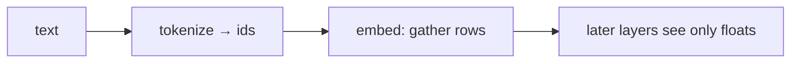

## Idea

### 1. What the embedding table is for

The embedding table is a matrix of shape `(vocab_size, dim)`.  
**Row `i` = the float row for token id `i`.**

One hard job, plus two related roles:

| Role | Plain meaning |
| --- | --- |
| **① Interface (required)** | Turn discrete ids into floats later layers can multiply/add. Without this, attention / MLP have no valid input |
| **② Learnable identity** | Each id owns a row; training rewrites those floats so frequent / related tokens become useful |
| **③ Often doubles as output scoring (optional)** | Small Llamas tie the same matrix to the LM head: gather in, score the vocab out |

It is **not** a dictionary gloss and **not** full-sentence understanding. At inference it is mostly: **gather row by id**.  
(Locker intuition: number = id, slip = the row; try the table above this lesson.)



### 2. Why the LLM pipeline needs it

The stack is a chain of **tensor** ops (matmuls, norms, attention…).  
Tokenization only yields integer ids. As category indices they are fine; as semantic numbers they are not—adding `id=3` and `id=7` has no linguistic meaning.

So you need a fixed, learnable translation:

- Input: id → float row (embedding)  
- Middle: compute only on floats  
- Output: scores over the vocab → new ids → tokenizer decodes to text  

Without an embedding table you’d invent another “id → first-layer input” scheme; modern decoders almost always choose **lookup**: simple, trainable, one-to-one with the vocab.

Vs the tokenizer table: tokenizer answers “text → ids”; embedding answers “ids → the computable world.” Both are required and must stay paired.

### 3. Where the embedding table comes from

**Not** hand-written floats per word, and **not** another BPE run.

| Stage | What happens |
| --- | --- |
| **Spec** | rows = tokenizer vocab size; cols = model dim (hyperparameter, e.g. 2048) |
| **Init** | allocate the table; fill with random floats (nearly meaningless) |
| **Pretrain** | next-token loss; backprop **updates the embedding with the rest of the net** |
| **Save** | write the checkpoint (`.safetensors`, etc.) beside attention, MLP, … |
| **You use it** | download the official model → load the trained table; inference gathers only |
| **Fine-tune (optional)** | keep updating floats, or append rows (new specials) and train more |

This lesson’s script builds a tiny **random toy table** so you see gather. Real Llama’s embedding lives in the official weights, factory-paired with its tokenizer.

### 4. What standards exist? What counts as a “good” table?

Split **hard constraints** (must not break) from **quality** (shows up after training).

**Hard constraints**

| Check | Plain meaning |
| --- | --- |
| **Shape** | rows = vocab; cols = `dim`; `T` ids → `T` rows |
| **Tokenizer pairing** | row `i` always matches tokenizer id `i` |
| **Usable numbers** | no NaN/Inf; scales don’t explode (RMSNorm etc. help) |
| **Stack contract** | if the stack assumes RoPE, don’t sneak absolute PE onto embeds unless you change the whole stack |

**“Good” — unlike the tokenizer table**

Tokenizers can be judged alone (fertility, parity, …).  
Embedding floats are **learned with the whole net**; labs rarely publish a fertility-style score for “the embedding alone.” People usually look at:

| Signal | Plain meaning |
| --- | --- |
| **Downstream / pretrain metrics** | better LM loss / evals under the same architecture — the main judge |
| **Dim budget** | too small → weak; too big → more params, hungrier for data. Set by architecture/compute, not “bigger is better” |
| **Rare tokens** | seldom-updated rows may stay undertrained; worse with huge vocabs |
| **Neighbor sanity (optional)** | nearest rows sometimes look like related pieces; a checkup, not the only score |
| **Tying** | small models often benefit from tying to the LM head; larger ones sometimes untie |

Bottom line:

- **Valid**: right shape, paired tokenizer, stable train/infer.  
- **Good**: the model scores well—embedding is one learnable part, **not a separate gold medal**.  
- Shipping a model: use the official embedding + official tokenizer; don’t bolt on a “better” foreign table.

### 5. What labs ship · what we do

Llama 3.2 / Qwen: lookup embed; position via RoPE; small models often tie the LM head.

`TokenEmbedding` in `arche/`: toy table for gather; real Llama ~128K rows, same idea.

## Run

```bash
python chapters/01-inference/ep03_embedding.py
```

Expect vocab size, dim, ids → output shape, and a note that position is not done here.

## Next

**RMSNorm** (`?c=rmsnorm`): steady scales before heavy layers.
