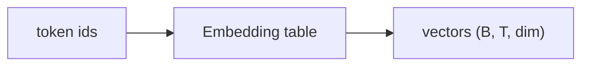

## Idea

### 1. Why embedding

Token ids are just integers. The network needs **vectors** it can multiply and add.

### 2. What it does

**Embedding** is a lookup table of shape `(vocab_size, dim)`: row `i` is the vector for id `i`. One forward = gather those rows. No “understanding” yet—only the first learnable map from symbols to geometry.



### 3. Design choices you will hear

| Choice | Plain idea | Today |
| --- | --- | --- |
| Absolute PE table added on embeds | Learn a vector per position | Rare as the main story in Llama-style stacks |
| **No PE here; RoPE later** | Position enters on Q/K | **Mainstream dense decoders** |
| Tied LM head | Same matrix for id→vec and vec→vocab scores | Common on small Llamas |

### 4. What labs ship

Llama 3.2 / Qwen-style dense: embedding lookup only; **RoPE** carries position; often **tie** embed ↔ LM head.

### 5. What “good” means here

- Shape `(B, T) → (B, T, dim)`  
- Same vocab as the tokenizer (row `i` ↔ id `i`)  
- Don’t sneak absolute PE back in if the rest of the stack assumes RoPE  

### 6. What we do

`TokenEmbedding` in `arche/`. Lab uses a tiny fake vocab so you need no download; shapes match the real idea.

## Run

```bash
python chapters/01-inference/ep03_embedding.py
```

Expect id/output shapes and a note that position is RoPE’s job.

## Next

**RMSNorm** (`?c=rmsnorm`): stabilize scales before heavy layers.
