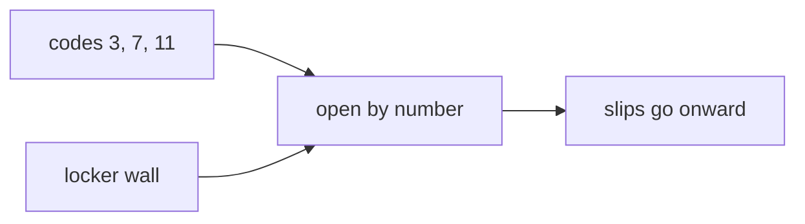

## Idea

### 1. Stuck on that sentence? Split it

Ignore “weight file” and “vector” for a moment. One picture:

**A wall of lockers.**

- Many lockers, numbered `0, 1, 2, 3…`  
- Each locker already holds a slip of paper with a few floats written on it  
- You hold pickup codes: `3, 7, 11`  
- You open locker 3 and take the slip; then 7; then 11  

**Embedding = open lockers by number and take the slips.**  
No understanding the sentence—just “this number → that locker → take what’s inside.”

The wall of slips lives in the downloaded model file; people call those floats part of the **weights**. For now, treat them as **already printed locker contents**.

### 2. Walk it with numbers

Suppose the wall has these lockers (fake numbers):

| locker | slip inside |
| --- | --- |
| 3 | `0.55, -0.17, 0.09, 0.22` |
| 7 | `0.03, 0.41, -0.28, 0.10` |
| 11 | `-0.12, 0.08, 0.33, -0.05` |

The tokenizer gave pickup codes `[3, 7, 11]`. After embedding you hold:

```
slip 1: 0.55, -0.17, 0.09, 0.22   ← from locker 3
slip 2: 0.03, 0.41, -0.28, 0.10    ← from locker 7
slip 3: -0.12, 0.08, 0.33, -0.05   ← from locker 11
```

**Before:** only three integers `3, 7, 11` (useless for real multiply-adds).  
**After:** three slips of floats (later layers only compute on these).

The tiny table above this lesson is that wall: type `3, 7, 11`, highlighted rows are the lockers you open, and below are the slips you took.

Why same-length slips? Later layers use one formula per token—teaching wall: 4 floats; Llama 3.2 1B: **2048**. “Vector” just means that slip.



### 3. Tokenizer and weights

Tokenizer: text → pickup code (id).  
Embedding: code → open locker, take slip.  
Weights: the floats in the lockers; the whole wall sits in the model file.

They must stay paired. If training always put `the` in locker 65, those floats were tuned for it; a foreign tokenizer that codes `the` as 902 still opens locker 902 → wrong slip.

Fresh / demo walls look random—**not semantics yet**. Training rewrites the slips over time.

### 4. Design choices you will hear

Older stacks sometimes add a second “position wall.” Llama-style usually **skips that here** and leaves order to **RoPE**. Small Llamas often reuse this wall for final vocab scoring.

This chapter only asks which locker; position comes later.

### 5. What labs ship

Llama 3.2 / Qwen: embedding = open by id; no absolute PE here; small models often tie the LM head. Vendors differ on locker count and slip length—**open-by-id** stays.

### 6. What “good” means · what we do

`T` ids → `T` same-length slips; locker `i` must match tokenizer id `i`; if RoPE follows, don’t add a PE table here.

`TokenEmbedding` in `arche/`: tiny fake wall, no download. Real Llama ~128K lockers, same action.

## Run

```bash
python chapters/01-inference/ep03_embedding.py
```

Expect real vs demo locker count, slip length, and id/output shapes.

## Next

**RMSNorm** (`?c=rmsnorm`): steady the scale of those slips before heavy layers.
