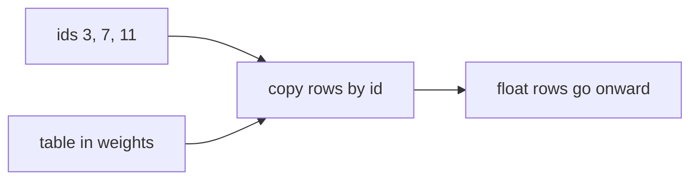

## Idea

### 1. Why this step exists

After the last chapter, the sentence is already a list of ids, e.g. `[3, 7, 11]`.

Later layers need multiply-adds and attention. **Ids alone are not usable raw material**—`3 + 7 = 10` has nothing to do with what the sentence meant. The model needs rows of floats it can actually compute with.

So the weight file holds a big table: one row per possible id, every row the same length. Embedding’s job is to copy the rows that match the ids you hold.

### 2. What embedding actually does

Still with `[3, 7, 11]` (fake numbers, only to show the action):

| id | floats on that row |
| --- | --- |
| **3** | **0.55, -0.17, 0.09, 0.22** |
| **7** | **0.03, 0.41, -0.28, 0.10** |
| **11** | **-0.12, 0.08, 0.33, -0.05** |

See `3` → copy row 3; see `7` → copy row 7; see `11` → copy row 11. You get three rows of floats. No sentence understanding, no dictionary lookup—**the whole step is copy-by-id**.

The tiny table above this lesson is the same action: type `3, 7, 11` and the highlighted rows are what get copied.

A few words people stumble on:

- **Vector**: just another name for “that row of floats”—nothing extra.  
- **Fixed length**: every row is the same length. Teaching table: 4 floats; Llama 3.2 1B: **2048**. Same length lets later layers use one formula for every token.  
- **Later layers only see these**: after embedding, they see neither the original text nor the ids `3 / 7 / 11`—only the float rows.

Think phone book or barcode: student id → that grade row; barcode → the price fields. Embedding is not a clever algorithm; it is this lookup.



### 3. How this ties to the tokenizer and weights

The tokenizer maps text ↔ id; the embedding maps id ↔ a row of floats. Those floats are part of the weights in the checkpoint.

The two tables must stay paired. If training always used `the` → id `65`, row 65 was tuned for that; a foreign tokenizer that maps `the` → `902` still copies row 902 → garbage. That’s the pairing story from the tokenizer lesson.

Fresh or demo tables look almost random—**not semantics yet**. Training slowly writes meaning into those numbers.

### 4. Design choices you will hear

Older stacks often add a second “position table” onto the copied rows. Llama-style dense decoders usually **skip that here** and leave “which place in the sequence” to **RoPE**. Small Llamas also often tie this embedding table to the final vocab-scoring layer to save parameters.

This chapter only asks which token (which row); position comes a few chapters later.

### 5. What labs ship

Llama 3.2 / Qwen-style: embedding is lookup, no absolute PE here, small models often tie the LM head. Vendors differ on row count, row length, and tying—**copy row by id** stays the same.

### 6. What “good” means · what we do

`T` ids in should become `T` rows of `dim` floats; row `i` must match tokenizer id `i`; if RoPE follows, don’t sneak a PE table back in here.

`TokenEmbedding` in `arche/` uses a tiny fake vocab so you need no download. Real Llama is ~128K rows with the same action, just a bigger table.

## Run

```bash
python chapters/01-inference/ep03_embedding.py
```

Expect real vs demo vocab size, row length, and id/output shapes.

## Next

**RMSNorm** (`?c=rmsnorm`): steady the scale of those float rows before the heavy layers.
