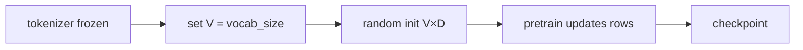

## Idea

After the tokenizer is frozen, the next from-scratch step is the **embedding table**: each id becomes a trainable float row. A bad table makes every later layer learn on noise; a mismatched tokenizer breaks the whole frontier pipeline.

### 1. What the embedding table is for

Matrix `(V, D)`: **row `i` = floats for id `i`** (`V` = vocab size, `D` = model dim).

| Role | Plain meaning |
| --- | --- |
| **① Interface** | discrete ids → tensors you can multiply/add |
| **② Learnable identity** | each token’s starting face; pretrain is the main author |
| **③ Often tied LM head** | small models share gather-in / score-out |

Inference ≈ **gather** by id (try the page table). Not a dictionary gloss.



### 2. From zero: how you generate the table

**Not** hand-filled, **not** another BPE. BPE assigns ids; embedding stores learnable floats.

| Step | What you do | Note |
| --- | --- | --- |
| **1. Lock V** | `V = tokenizer size` (incl. specials) | same factory as previous chapter |
| **2. Choose D** | e.g. **2048** for Llama 3.2 1B | architecture hyperparameter |
| **3. Build module** | `nn.Embedding(V, D)` | random init |
| **4. Tie or not** | small models often tie embed ↔ lm_head | larger sometimes untie |
| **5. Pretrain** | next-token CE; grads update **seen rows** | grows with the whole net |
| **6. Save** | `embed_tokens.weight` in checkpoint | infer = load + gather |
| **7. Changes** | new specials → **grow rows + train**; new tokenizer → **rebuild** | costs differ by orders of magnitude |

Init is an empty locker wall; **training writes the numbers**. This lesson’s toy table shows gather + one update; real tables come from official weights or your pretrain.

### 3. What counts as a good table

**Hard constraints**

| Check | Plain meaning |
| --- | --- |
| **Shape** | `(V, D)` matches config/tokenizer; `T` ids → `T` rows |
| **Pairing** | row `i` ↔ tokenizer id `i` |
| **Healthy values** | no NaN/Inf; RMSNorm can steady scales |
| **Contract** | this stack: RoPE later; no absolute PE on embeds |

**Optimization targets** (rarely a solo “embedding score”)

| Check | Plain meaning | Whole-model impact |
| --- | --- | --- |
| **Fits pretrain objective** | frequent rows get updates | base LM skill |
| **Dim budget** | too small → weak; too big → hungry | capacity vs stability |
| **Rare tokens** | long-tail ids barely move | weak rare words |
| **Tying** | tie often helps small models | params & output calibration |
| **Downstream / loss** | same-architecture compare | **main judge** |

Unlike fertility, embedding quality is judged mainly via the **full model** under a fixed setup.

### 4. How to improve · impact on the whole LLM

| Lever | How | Whole-model impact |
| --- | --- | --- |
| **Better pretrain** | data, steps, stability | main path: embeds improve with the net |
| **Change D** | width | global capacity; requires retrain |
| **Tie / untie LM head** | share or split | small models often tie |
| **Grow vocab** | append rows (random/mean/subword init) + continue train | new specials/domains; keep old rows |
| **Change tokenizer** | new V | **rebuild embeds + re-pretrain** (or costly migration) |
| **Warm-start rows** | copy from a related model | can speed convergence; wrong pairing destroys the model |
| **Freeze embeds in FT** | small data | less overfit; may cap expressivity |

From-zero order: freeze tokenizer → set `V,D` & tying → random embed + pretrain → append rows only when protocols need new specials. **Never** mix Llama embeds with a Qwen tokenizer.

### 5. Industry · well-known open models

| Model / line | How embeddings are done | Notes |
| --- | --- | --- |
| **Llama 3 / 3.2** | lookup; small sizes often **tie** LM head; **no** absolute PE on embeds | **course specimen**; RoPE for position |
| **Qwen** | lookup + RoPE; V from their tokenizer | strict pairing |
| **DeepSeek** | lookup; frontier focus on MLA/MoE etc. | multilingual tokenizer makes rows “worth more” |
| **GPT line (public)** | larger V → larger embed; generation bumps rebuild embeds | `o200k` isn’t a light patch on `cl100k` embeds |
| **BERT era** | token + segment + **absolute position** embeds | unlike modern decoder “pure lookup + RoPE” |
| **MoE LLMs** | usually still a shared lookup; sparsity in FFN experts | embed isn’t the MoE headline, but V still costs |

Consensus: embeddings are a **learnable lookup** factory-paired with the tokenizer; improving them ≈ better pretrain/tokenizer; open checkpoints store the matrix in safetensors—you write the same when training from zero.

### 6. Code (this course)

```python
self.weight = nn.Embedding(vocab_size, embed_dim)
return self.weight(token_ids)
```

```bash
python chapters/01-inference/ep03_embedding.py
```

Expect shape, gather, mean |Δ| after one step, finiteness. Real Llama 1B: `V≈128256`, `D=2048` in the official checkpoint.

## Run

```bash
python chapters/01-inference/ep03_embedding.py
```

## Next

**RMSNorm** (`/rmsnorm/`): how to steady scales after embedding—critical when training deep nets from zero.
