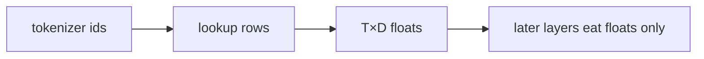

## Idea

The tokenizer only emits **integer ids**. A neural net cannot “understand” the number `42`—it only adds/multiplies tensors. So there must be a step: **use the id to look up a row of floats** in a big table. That table is the **embedding**.

### 1. How does an id become floats—and why bother?

Think **locker wall**, not a dictionary gloss:

1. Tokenizer says: this text became ids `7, 3, 7`
2. There are `V` lockers (vocab size); each holds exactly **`D` floats** (`D=2048` in Llama 3.2 1B)
3. **Id → floats = open that locker and copy the row out** (`gather` / `nn.Embedding`)  
   - id `7` → row 7’s `D` numbers  
   - id `3` → row 3  
   - the same id **always** hits the same row (random at init; training rewrites the numbers)

Tiny fake example (`D=3`):

| id | embedding row |
| --- | --- |
| 3 | `0.2, -0.1, 0.5` |
| 7 | `-0.3, 0.8, 0.1` |

Ids `[7, 3, 7]` → three rows: row 7, then row 3, then row 7 again. **No formula turns 7 into floats**—it is a lookup.

**Why floats at all?**

| With only ids | With embeddings |
| --- | --- |
| Ids are labels; you cannot really matmul them with weights | Attention / FFN **only eat float tensors** |
| `cat=3` vs `dog=9` has no geometry | Training nudges rows so co-occurring tokens get useful starting faces |
| Renumbering the tokenizer breaks everything | Row index must stay locked to tokenizer id |

One line: **tokenizer numbers tokens; embedding gives each number a trainable vector the rest of the net can compute on.** Bad table ⇒ later layers train on noise; wrong pairing with the tokenizer ⇒ the pipeline is junk.

**Where do those floats come from?**  
At first they are **random** (almost no meaning). Then the whole net trains on next-token prediction; wrong guesses backprop and **rewrite rows that showed up**—frequent tokens move most. Results are saved in the checkpoint; inference only loads and gathers. This course can also load Llama’s already-trained rows.

**Why a float row per token at all?**  
Later layers are continuous math (matmul, add, nonlinearities). Integer ids are not valid inputs for that; float rows are. Training tends to push co-occurring / similar-role tokens into vectors that help “guess the next token”—a side effect of the objective, not hand-drawn word maps.

The playground on this page is exactly “gather by id.”



### 2. From zero: how you generate the table

**Not** hand-filled glosses, **not** another BPE. BPE assigns ids; embedding stores the float rows—mostly **written by pretrain**.

| Step | What you do | Note |
| --- | --- | --- |
| **1. Lock V** | `V = tokenizer size` (incl. specials) | same factory as previous chapter |
| **2. Choose D** | e.g. **2048** for Llama 3.2 1B | architecture hyperparameter |
| **3. Build module** | `nn.Embedding(V, D)` | random init |
| **4. Tie or not** | small models often tie embed ↔ lm_head | larger sometimes untie |
| **5. Pretrain** | next-token CE; grads update **seen rows** | grows with the whole net |
| **6. Save** | `embed_tokens.weight` in checkpoint | infer = load + gather |
| **7. Changes** | new specials → **grow rows + train**; new tokenizer → **rebuild** | costs differ by orders of magnitude |

Init is an empty locker wall; **training writes the numbers**. This lesson’s toy table shows gather + one update; real tables come from official weights or your pretrain.

### 3. What counts as a good table

**Hard constraints**

| Check | Plain meaning |
| --- | --- |
| **Shape** | `(V, D)` matches config/tokenizer; `T` ids → `T` rows |
| **Pairing** | row `i` ↔ tokenizer id `i` |
| **Healthy values** | no NaN/Inf; RMSNorm can steady scales |
| **Contract** | this stack: RoPE later; no absolute PE on embeds |

**Optimization targets** (rarely a solo “embedding score”)

| Check | Plain meaning | Whole-model impact |
| --- | --- | --- |
| **Fits pretrain objective** | frequent rows get updates | base LM skill |
| **Dim budget** | too small → weak; too big → hungry | capacity vs stability |
| **Rare tokens** | long-tail ids barely move | weak rare words |
| **Tying** | tie often helps small models | params & output calibration |
| **Downstream / loss** | same-architecture compare | **main judge** |

Unlike fertility, embedding quality is judged mainly via the **full model** under a fixed setup.

### 4. How to improve · impact on the whole LLM

| Lever | How | Whole-model impact |
| --- | --- | --- |
| **Better pretrain** | data, steps, stability | main path: embeds improve with the net |
| **Change D** | width | global capacity; requires retrain |
| **Tie / untie LM head** | share or split | small models often tie |
| **Grow vocab** | append rows (random/mean/subword init) + continue train | new specials/domains; keep old rows |
| **Change tokenizer** | new V | **rebuild embeds + re-pretrain** (or costly migration) |
| **Warm-start rows** | copy from a related model | can speed convergence; wrong pairing destroys the model |
| **Freeze embeds in FT** | small data | less overfit; may cap expressivity |

From-zero order: freeze tokenizer → set `V,D` & tying → random embed + pretrain → append rows only when protocols need new specials. **Never** mix Llama embeds with a Qwen tokenizer.

### 5. Industry · well-known open models

| Model / line | How embeddings are done | Notes |
| --- | --- | --- |
| **Llama 3 / 3.2** | lookup; small sizes often **tie** LM head; **no** absolute PE on embeds | **course example**; RoPE for position |
| **Qwen** | lookup + RoPE; V from their tokenizer | strict pairing |
| **DeepSeek** | lookup; frontier focus on MLA/MoE etc. | multilingual tokenizer makes rows “worth more” |
| **GPT line (public)** | larger V → larger embed; generation bumps rebuild embeds | `o200k` isn’t a light patch on `cl100k` embeds |
| **BERT era** | token + segment + **absolute position** embeds | unlike modern decoder “pure lookup + RoPE” |
| **MoE LLMs** | usually still a shared lookup; sparsity in FFN experts | embed isn’t the MoE headline, but V still costs |

Consensus: embeddings are a **learnable lookup** factory-paired with the tokenizer; improving them ≈ better pretrain/tokenizer; open checkpoints store the matrix in safetensors—you write the same when training from zero.

### 6. Code (this course)

```python
self.weight = nn.Embedding(vocab_size, embed_dim)
return self.weight(token_ids)
```

```bash
python chapters/01-inference/ep03_embedding.py
```

Expect shape, gather, mean |Δ| after one step, finiteness. Real Llama 1B: `V≈128256`, `D=2048` in the official checkpoint.

## Run

```bash
python chapters/01-inference/ep03_embedding.py
```

## Next

**RMSNorm** (`/rmsnorm/`): how to steady scales after embedding—critical when training deep nets from zero.
