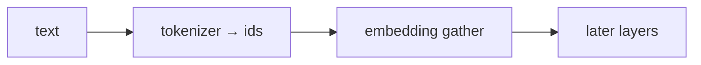

## Idea

### 1. What the embedding table is for

A matrix `(vocab_size, dim)`: **row `i` = the float row for token id `i`.**

| Role | Plain meaning |
| --- | --- |
| **① Interface** | ids → floats later layers can multiply/add |
| **② Learnable identity** | one row per id; training rewrites those floats |
| **③ Often tied LM head** | small Llamas: gather in, score vocab out with the same matrix |

At inference it’s mostly **gather by id** (try the table above). Not a dictionary gloss.



### 2. Why the LLM pipeline needs it

Tokenization only yields integers; `3+7=10` has no linguistic meaning. The stack needs a learnable map from ids into tensor-land. Modern decoders use a lookup table: simple, trainable, one row per id.

### 3. How the embedding table is generated

**Not** hand-written floats, and **not** another BPE pass. The tokenizer names ids; the embedding stores learnable floats for those ids.

| Stage | What happens |
| --- | --- |
| **1. Shape** | rows = vocab size; cols = model dim |
| **2. Init** | `nn.Embedding`: random floats (nearly meaningless) |
| **3. Pretrain** | next-token loss; backprop **updates rows that appear** (and other layers) |
| **4. Save** | checkpoint beside attention, MLP, … |
| **5. You use it** | load trained weights; inference gathers only |
| **6. Fine-tune (optional)** | keep updating, or append rows for new specials |

| | Tokenizer table | Embedding table |
| --- | --- | --- |
| How built | BPE-style merges on text | random init + **gradients** |
| Artifact | `tokenizer.json`, etc. | `embed_tokens.weight` in the checkpoint |
| At inference | encode/decode | gather by id |

### 4. Code: build · gather · train one row

Library (`arche/embedding.py`):

```python
class TokenEmbedding(nn.Module):
    def __init__(self, vocab_size: int, embed_dim: int) -> None:
        super().__init__()
        self.weight = nn.Embedding(vocab_size, embed_dim)  # (V, D)

    def forward(self, token_ids: torch.Tensor) -> torch.Tensor:
        return self.weight(token_ids)  # gather rows
```

“Generation” happens in training—one toy step (same idea as the chapter script):

```python
emb = TokenEmbedding(vocab_size=32, embed_dim=8)  # random init = create table
ctx = torch.tensor([[3, 7, 11]])
target = torch.tensor([5])
h = emb(ctx)[:, -1, :]
loss = F.cross_entropy(head(h), target)
loss.backward()
opt.step()  # row 11 (last context id) moves
```

Full demo (toy table, no download):

```bash
python chapters/01-inference/ep03_embedding.py
```

Expect table shape, gathered rows, mean |Δ| on a touched row after one SGD step, finite checks.

Real Llama embedding lives in the official checkpoint (~`128256` × `2048` for 1B); must pair with the official tokenizer.

### 5. What “good” means

**Hard constraints**

| Check | Plain meaning |
| --- | --- |
| **Shape** | `(V, D)`; `T` ids → `T` rows |
| **Pairing** | row `i` ↔ tokenizer id `i` |
| **Numbers** | no NaN/Inf; scales sane |
| **Stack contract** | RoPE later; no sneaky absolute PE here |

**Quality (unlike tokenizers)**

Fertility-style solo scores are rare. Embedding floats are trained with the whole net:

| Signal | Plain meaning |
| --- | --- |
| **Pretrain / downstream** | loss and evals under the same architecture — main judge |
| **Dim budget** | too small → weak; too big → data-hungry |
| **Rare tokens** | idle rows barely update |
| **Neighbor sanity** | optional checkup |
| **Tying** | small models often tie the LM head |

Valid = shape + pairing + stable train/infer. Good = the model scores well. Shipping: official embed + official tokenizer only.

### 6. What labs ship · what we do

Llama 3.2 / Qwen: lookup; RoPE for position; small models often tie the LM head.  
This lesson: `TokenEmbedding` toy gather + one update; real table in the checkpoint.

## Run

```bash
python chapters/01-inference/ep03_embedding.py
```

## Next

**RMSNorm** (`?c=rmsnorm`): steady scales before heavy layers.
