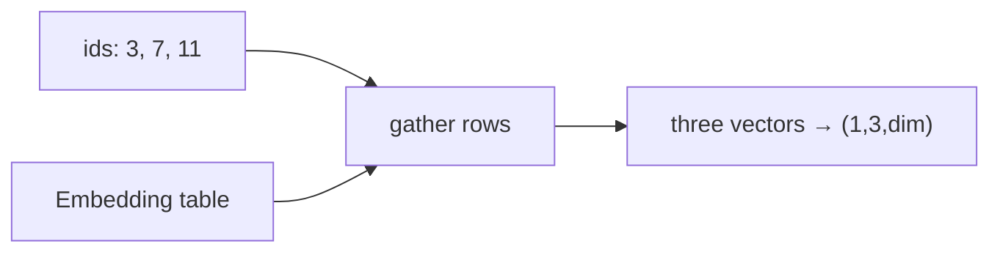

## Idea

### 1. Why embedding

The last chapter left you with **token ids**, e.g. `[3, 7, 11]`.

Ids are only labels—“cabinet 3”, “cabinet 7”. The network multiplies and attends; it needs **lists of floats**, not cabinet numbers.

**Embedding** assigns every id a fixed-length list of numbers (a **vector**). From here on, the stack eats those vectors.

One line: **tokenizer gives ids; embedding turns ids into rows you can compute with.**

### 2. What it does (lookup)

Think of a spreadsheet:

| id (row) | dim 0 | dim 1 | dim 2 | … |
| --- | --- | --- | --- | --- |
| 0 | 0.12 | -0.04 | 0.31 | … |
| 1 | -0.22 | 0.08 | 0.01 | … |
| 3 | **0.55** | **-0.17** | **0.09** | … |
| 7 | **0.03** | **0.41** | **-0.28** | … |
| … | … | … | … | … |

- **vocab size** rows (one per possible id)  
- **dim** floats per row (2048 for Llama 3.2 1B)  
- Forward pass is mostly **gather rows by id**—not “understanding” yet

Example: ids `[3, 7, 11]` → shape `(1, 3, dim)` = rows 3, 7, and 11 stacked.



Try the **tiny table** above the lesson (click ids, see which rows light up). The script below uses the same idea with a fake vocab so you need no download.

### 3. How this ties to the tokenizer and weights

| Idea | Plain meaning |
| --- | --- |
| **Tokenizer table** | text ↔ id (previous chapter) |
| **Embedding table** | id ↔ that row of floats |
| **Weights** | those floats are learned and stored in the checkpoint |

So **one tokenizer + matching embedding** must stay paired.  
If training saw `the` → id `65`, row 65 became “the”. A foreign tokenizer that maps `the` → `902` still reads row 902 → garbage (the pairing story from the tokenizer lesson lands here).

Fresh or demo tables look almost random—**no semantics yet**. Meaning is trained later; embedding is only the first learnable map from symbols into geometry.

### 4. Design choices you will hear

| Choice | Plain idea | Today |
| --- | --- | --- |
| Absolute PE added on embeds | Learn a vector per position; add it on | Older stacks; **not** the Llama-style main path |
| **No PE here; RoPE later** | Position enters as rotations on Q/K | **Mainstream dense decoders** |
| **Tied LM head** | Reuse the same matrix for id→vec and vec→vocab scores | Common on small Llamas |

Easy mix-up: **position is not this chapter’s job**. The table says “which token”; “which place in the sequence” waits for **RoPE**.

### 5. What labs ship

Llama 3.2 / Qwen-style dense:

- Embedding = **lookup** (`nn.Embedding` or equivalent)  
- **No** absolute PE added on the embed  
- Small models often **tie** embed ↔ LM head  

Vendors differ on vocab size, dim, tying; “id → take a row” is the same idea.

### 6. What “good” means · what we do

| Check | Plain meaning |
| --- | --- |
| Shape | `(B, T)` ids → `(B, T, dim)` vectors |
| Pairing | row `i` ↔ tokenizer id `i` |
| Position | If the stack assumes RoPE, don’t sneak absolute PE back in here |

`TokenEmbedding` in `arche/`. The lab uses a tiny fake vocab (e.g. 32 rows)—**no real weight download**; real Llama vocab is ~128K rows with the same logic. When you run the script, check id/output shapes and the note that position is RoPE’s job.

## Run

```bash
python chapters/01-inference/ep03_embedding.py
```

Expect real vs demo vocab size, `embed_dim`, and id/output shapes.

## Next

**RMSNorm** (`?c=rmsnorm`): stabilize scales before the heavy layers.
