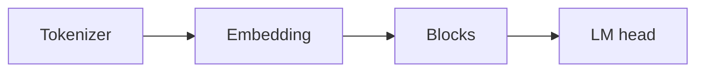

## Idea

We hand-write a small **Llama 3.2** (~1B parameters): small enough to hold in your head, downloadable weights, same parts used in production. People often call this “layers that all run, then guess the next token” a **dense decoder**—learn the name as you go. Goal: own every block of the forward pass.



## Run

```bash
python chapters/01-inference/ep01_overview.py
```

Prints config sizes (layers, heads, dim)—not chat.

## Next

**Tokenizer** (`?c=tokenizer`).
