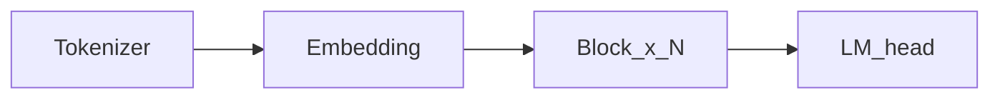

## In one sentence
You will see the big picture of a modern dense language model—and why this course does not start with GPT-2.

## Before you start
- Finish Part 0 (especially the journey map).
- Time: about 12 minutes.
- Optional: run the companion script after reading.

## The idea (plain language)
A **dense decoder** reads tokens from left to right and predicts the next one. Inside, the same kind of block repeats many times. Modern stacks prefer:

- **RMSNorm** to stabilize numbers
- **RoPE** to encode position by rotating vectors
- **SwiGLU** as the feed-forward recipe
- **GQA** so key/value memory stays smaller while decoding

**Llama 3.2 lineage** means we follow that recipe (1B is the teaching target). Capability later comes from official weights; understanding comes from writing the forward pass.



## Picture / formula
Keep the diagram above in mind. Formulas appear when a chapter needs them.

## In the code
- Config helpers: `arche/config.py` (`llama32_1b`)
- Companion: `chapters/01-inference/ep01_overview.py` prints sizes (layers, heads, dim)—not chat text.

## Do this now
```bash
python chapters/01-inference/ep01_overview.py
```
You should see numbers for vocab size, layers, and heads.

## If something breaks
- `No module named arche` → activate `.venv` and run from the repo root.
- Script not found → `cd` into the `arche` folder first.

## Don't worry about yet
Training giant models, serving millions of users, or every Llama variant.

## Next
**Tokenizer** (`?c=tokenizer`).
