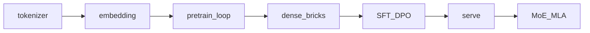

## Idea

This chapter is the **course map**: one path from zero toward frontier-ready, with **Llama 3.2 ~1B** as the running dense example. You will print its config early so sizes stay real, not hand-wavy.

If the example recipe drifts, later “how industry does it” will not line up. The spine is tables → next-token train → bricks → align → serve → MoE/MLA—each brick gets a place on that line before the details matter.

In practice: nail the example → grow tokenizer and embed → train next-token (objective → data → optim → scale) → hand-write RMSNorm…stack → load, generate, HF checks → SFT/DPO → serve → frontier primers.

### The path

| Stage | Plain words |
| --- | --- |
| **0 Start** | Setup; read a chapter; run one command |
| **1 Tables + train + bricks** | Tokenizer → embedding → **pretrain×4** → RMSNorm…stack → weights → generate → HF |
| **2 Align** | SFT / DPO |
| **3 Serve faster** | KV, RoPE scaling, device/quant/chat, continuous batch, paging |
| **4 Frontier** | MoE → MLA → ckpt → shards |



You hand-write a **Llama 3.2-style dense decoder**. Official Llama files are that recipe’s finished pair—not a second curriculum.

### Why Llama 3.2 ~1B

Same brick set as larger Llama 3 and many Qwen-class dense stacks: **RMSNorm + RoPE + GQA + SwiGLU + byte BPE**. At ~1B, vocab, width, depth, and head counts stay countable and the weights are downloadable—**frontier-shaped architecture at a teachable scale**.

| Pick | Meaning |
| --- | --- |
| Frontier-shaped bricks | Names match current open dense + serving code |
| Teachable scale | Finishable from zero |
| Open finished pair | Tokenizer + checkpoint for real checks |
| Dense first | MoE/MLA later as maps |

This is not “smartest chatbot” and not “train 70B at home.”

### Where DeepSeek fits

| | **Llama 3.2 (example)** | **DeepSeek-V2/V3** |
| --- | --- | --- |
| Capacity | Dense FFN | **MoE** top-k experts |
| KV | **GQA** | **MLA** latents |
| In-course | Parts 1–3 | Part 4 primers |

Same Transformer family; different upgrades. You build the dense trunk first.

### Config you will keep seeing

The lab ([`ep01_overview.py`](https://github.com/chaxus/arche/blob/main/chapters/01-inference/ep01_overview.py)) prints [`llama32_1b()`](https://github.com/chaxus/arche/blob/main/arche/config.py):

| Field | ~1B idea |
| --- | --- |
| `vocab_size` | 128256 |
| `num_layers` | 16 |
| `embed_dim` | 2048 |
| `num_heads` / `num_kv_heads` | 32 / 8 (GQA) |
| `rope_theta` | 500000 |

### Check yourself

- Config is self-consistent; bricks match the claimed recipe.
- From zero still works: tables trainable, net stackable, weights loadable.
- Docs and obtainable weights exist; MoE/MLA primers have somewhere to attach.

### Changing the example

Swap the example (e.g. Qwen) and you retarget tokenizer, embeds, and blocks. Wider or deeper means retrain. This course keeps 1B and uses primers for larger ideas.

### In this repo

```bash
python chapters/01-inference/ep01_overview.py
```

Prints sizes—not a chatbot yet.

## Run

```bash
python chapters/01-inference/ep01_overview.py
```

## Next

**Tokenizer** (`/tokenizer/`): grow the first table from zero.
