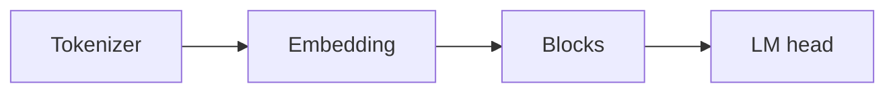

## Idea

### 1. Why this specimen

We need one small, open, production-like model to hand-write end to end.

### 2. What “the model” is here

A **Llama 3.2–style** next-token stack: tokenizer → embed → blocks → LM head. People call this a **dense decoder**—learn the name as you go.



### 3–5. Why Llama 3.2

~1B, downloadable weights, same bricks as many production dense models (RMSNorm, RoPE, SwiGLU, GQA). Later parts add inference, tiny train, and frontier primers.

### 6. What we do

Print config sizes in the lab—not chat yet.

## Run

```bash
python chapters/01-inference/ep01_overview.py
```

## Next

**Tokenizer** (`?c=tokenizer`).
