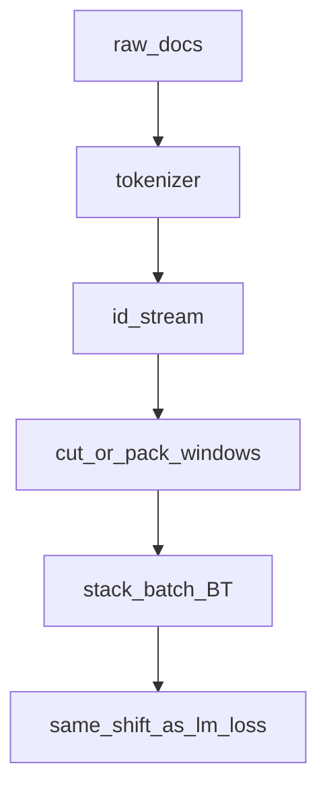

## Idea

Pretraining needs tensors the loss can actually score: **`(batch, time)` id matrices** built from raw text. The path is document → tokenize → pack or cut fixed windows → batch → (optional) pad and mask. The objective from the previous chapter is fixed; **data shape** decides what signal each step sees. Bad windows—padding counted as labels, leaked future context, sloppy packing—quietly waste or corrupt training. Keep **labels aligned with the same shift rule** as `lm_loss`, whether you shift in the collator or inside the model.

### What goes into a batch

| Piece | Role |
| --- | --- |
| **document** | Raw text (web, books, code, …) |
| **token ids** | Tokenizer output (BPE etc.) |
| **window / block** | Length-`T` slice the model sees at once (`T` ≈ context) |
| **batch** | Stack `B` windows → shape `(B, T)` |
| **labels** | Same ids, interpreted with shift (or HF’s internal shift) |

Two common layouts:

| Layout | Idea |
| --- | --- |
| **Sliding / chunked** | Cut long token streams into non-overlap or stride-`T` blocks (nanoGPT style) |
| **Packed** | Concatenate many short docs with separators / attention boundaries so GPUs stay full |

### Design pressures

| Pressure | Consequence |
| --- | --- |
| GPU likes dense `(B,T)` | Prefer packing over tiny ragged sequences |
| Context length `T` | Caps how far “next token” can look back |
| Pad tokens | Must **not** train as if they were real next words (mask or ignore_index) |
| Doc boundaries | Blind concat can invent fake “next tokens” across unrelated docs unless you mask |

### Toy windows in this repo

Lab batches are random ids for teaching the **loop**, not real corpora:

```python
# ep18-style: B windows of length T, vocab V
batch = torch.randint(0, V, (B, T))
logits, _ = model(batch)
loss = lm_loss(logits, batch)  # uses batch[:, 1:] as targets
```

Production sketch (conceptual, nanoGPT-like):

```python
# tokens: 1D long stream of ids
ix = torch.randint(0, len(tokens) - T, (B,))
x = torch.stack([tokens[i : i + T] for i in ix])
y = torch.stack([tokens[i + 1 : i + T + 1] for i in ix])
# then CE(model(x), y)  — y already shifted; don't shift again
```

**HF:** if collator leaves `labels == input_ids`, the **model** shifts; if you build `y` yourself, your CE must **not** shift again.



### Check yourself

- Every supervised position has a real next id (or is masked out).
- Label/input shift matches your loss implementation—no double shift.
- Token utilization is high (little pure padding).
- The domain mix matches what you want the model to learn.

### Levers for the whole model

| Lever | Impact |
| --- | --- |
| Cleaner / more tokens | Stronger base model |
| Longer `T` | Better long-range next-token skill (cost ↑) |
| Packing quality | Throughput and effective updates/day |
| Domain mix | What the model becomes “fluent” at |

### This course

No separate script yet—reuse:

```bash
python chapters/02-training/ep18_pretrain.py
```

Treat random batches as “fake windows.” Real dataloaders appear when you leave the toy spine.

## Run

```bash
python chapters/02-training/ep18_pretrain.py
```

## Next

**Pretrain optim** (`/pretrain-optim/`): AdamW, lr, grad clip, accumulation.
