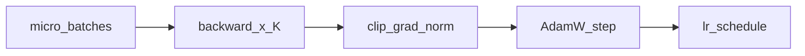

## Idea

Once the loss is right, **the optimizer side** of each step decides whether weights move in a stable way. AdamW, learning rate (and schedules), gradient clipping, and gradient accumulation are the usual knobs. Correct CE with a bad optimizer still gives NaNs, divergence, or a flat loss—past toy scale, **how you step** is what makes a run finish. The skeleton is: `zero_grad` → forward → loss → `backward` → (optional clip) → `optimizer.step` → (optional lr schedule; accumulate over micro-batches when VRAM forces small `B`).

### Knobs you will touch

| Knob | Role |
| --- | --- |
| **AdamW** | Adaptive moments + **decoupled weight decay** (default in Llama/nanoGPT-style recipes) |
| **lr** | Step size; too high → explode; too low → crawl |
| **schedule** | Warmup then decay (cosine / WSD / …) so early steps don’t thrash random embeds |
| **grad clip** | Cap global grad norm (e.g. 1.0) against spikes |
| **grad accum** | Sum grads over `K` micro-batches ≈ larger effective batch |

This repo’s toy loop ([`train_pretrain_steps`](https://github.com/chaxus/arche/blob/main/arche/train/pretrain.py)):

```python
opt = torch.optim.AdamW(model.parameters(), lr=lr)
for batch in batches:
    opt.zero_grad(set_to_none=True)
    logits, _ = model(batch)
    loss = lm_loss(logits, batch)
    loss.backward()
    opt.step()
```

No schedule or clip yet—on purpose. Production adds them around the same skeleton.

### Why each piece exists

| Choice | Rationale |
| --- | --- |
| AdamW over plain SGD | Sparse-ish token grads + many params; adaptive scales help |
| Weight decay | Mild regularization; AdamW’s form matches LLM practice |
| Warmup | Early CE is huge (`~log V`); blunt lr shreds init |
| Clip | One bad batch shouldn’t blow FP math |
| Accum | Fit long `T` / big models on limited VRAM while keeping effective batch |

### Gradient accumulation sketch

```python
opt.zero_grad(set_to_none=True)
for micro in micro_batches:
    loss = lm_loss(*model_and_shift(micro)) / K
    loss.backward()          # grads accumulate
torch.nn.utils.clip_grad_norm_(model.parameters(), 1.0)
opt.step()
# scheduler.step()  # if any
```



### Check yourself

- No NaN/Inf in loss or grads after clip.
- `zero_grad` runs once per **optimizer** step—not forgotten under accumulation.
- Loss trends down over a sensible window.
- When you scale up, lr schedule matches a known recipe.

### Levers for the whole model

| Lever | Impact |
| --- | --- |
| lr / warmup | Trainability of deep stacks + embeds |
| effective batch (B×accum×world) | Noise vs stability of updates |
| clip threshold | Spike survival vs under-updating |
| Wrong decay | Over-shrink or under-regularize weights |

### This course

```bash
python chapters/02-training/ep18_pretrain.py
```

Page demo: try higher lr until loss misbehaves—that’s the optim lesson in miniature.

## Run

```bash
python chapters/02-training/ep18_pretrain.py
```

## Next

**Pretrain scale** (`/pretrain-scale/`): how frontier recipes stretch the same loop.
