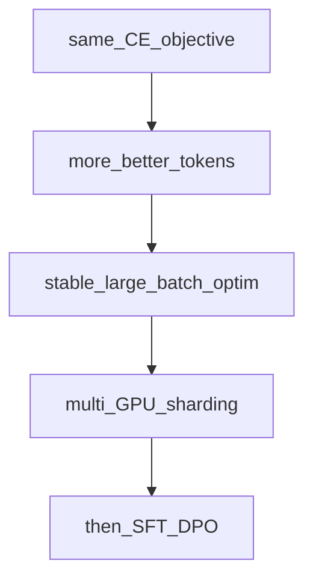

## Idea

The next-token loop you already know is the same one frontier labs run—they stretch it with **more tokens, staged recipes, and parallelism**, not a different objective. Llama 3.2 ~1B and trillion-token runs share **CE + one step**; they differ in data volume, lr schedules, cluster math, and sometimes **architecture** (dense vs MoE). This chapter is a map so “toy loss went down” does not feel like graduation. Read published recipes as extensions of pretrain, pretrain-data, and pretrain-optim: same loss, harder data, optim, and engineering.

### Axes that change with scale

| Axis | Toy (this course) | Frontier-shaped |
| --- | --- | --- |
| **Tokens** | A few random batches | Trillions of real tokens |
| **Steps / stages** | One flat loop | Multi-stage LR, data mixes, context lengthening |
| **Batch** | Tiny `B,T` | Huge effective batch via accum + data parallel |
| **Model** | Tiny dense `Llama` | Dense 1B–70B+ or MoE (DeepSeek) with MLA/experts |
| **Hardware** | One process | Megatron/FSDP/pipeline-style sharding |

Llama 3-style public reports: long pretrain on curated mixes, then shorter high-quality anneal / long-context phases—still next-token at heart.

DeepSeek-V2/V3: **same causal LM family**, different **block** (MLA + MoE)—see Frontier chapters; training still CE + big-data optim.

### Common illusions after ep18

| Illusion | Reality |
| --- | --- |
| “Loss fell on random ids” | Proves the **loop**, not language skill |
| “Copy AdamW defaults” | Defaults need warmup/schedule/clip at scale |
| “Bigger model only” | Data quality × tokens often dominate |
| “SFT will fix a bad base” | Align edits style; weak pretrain stays weak |

### Reading a recipe in four lines

When you open Llama / DeepSeek / Megatron writeups, map:

1. **Objective** → still next-token CE (Pretrain)  
2. **Data** → mixes, packing, context schedule (Pretrain data)  
3. **Optim** → AdamW, lr shape, clip, effective batch (Pretrain optim)  
4. **Systems** → parallel strategy, precision, checkpointing (later / ops)



### Check yourself

- You can name which axis a paper changed (data, optim, systems, arch).
- MoE **architecture** is not a different **loss**.
- You expect more engineering before “reproduce Llama.”

### Levers for the whole model

| Lever | Impact |
| --- | --- |
| Token budget | Primary capability driver |
| Staged data / LR | Stability + late quality |
| Parallel efficiency | Whether the budget is usable |
| Arch (GQA/MoE/MLA) | Cost per token & memory—not a new objective |

### This course

Still the toy entry:

```bash
python chapters/02-training/ep18_pretrain.py
```

Next in the spine: dense **bricks** (RMSNorm→…) so the forward behind `model(batch)` is no longer a black box—then HF weight align, then **SFT/DPO**.

## Run

```bash
python chapters/02-training/ep18_pretrain.py
```

## Next

**RMSNorm** (`/rmsnorm/`): first trunk brick inside the forward you just trained.
