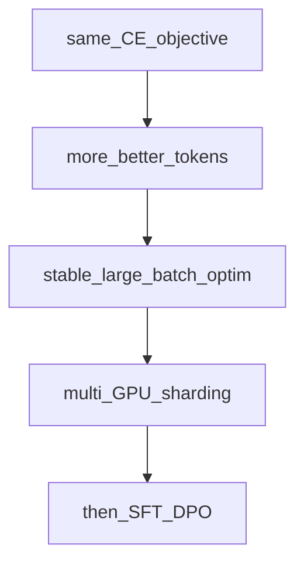

## Idea

**What:** A **primer** on scaling the same next-token loop—more tokens, stages, parallelism—without leaving the beginner spine for a full systems course.

**Why:** Llama 3.2 ~1B and frontier runs share **objective + step**; they differ in **data volume, staged recipes, cluster math, and (sometimes) architecture** (dense vs MoE). Knowing the map prevents “my toy loss went down, so I’m done.”

**How:** Read published recipes as *extensions* of chapters you already have: same CE, harder data/optim/engineering.

### 1. What — scale axes

| Axis | Toy (this course) | Frontier-shaped |
| --- | --- | --- |
| **Tokens** | A few random batches | Trillions of real tokens |
| **Steps / stages** | One flat loop | Multi-stage LR, data mixes, context lengthening |
| **Batch** | Tiny `B,T` | Huge effective batch via accum + data parallel |
| **Model** | Tiny dense `Llama` | Dense 1B–70B+ or MoE (DeepSeek) with MLA/experts |
| **Hardware** | One process | Megatron/FSDP/pipeline-style sharding |

Llama 3-style public reports: long pretrain on curated mixes, then shorter high-quality anneal / long-context phases—still next-token at heart.

DeepSeek-V2/V3: **same causal LM family**, different **block** (MLA + MoE)—see Frontier chapters; training still CE + big-data optim.

### 2. Why — why not stop at ep18

| Illusion | Reality |
| --- | --- |
| “Loss fell on random ids” | Proves the **loop**, not language skill |
| “Copy AdamW defaults” | Defaults need warmup/schedule/clip at scale |
| “Bigger model only” | Data quality × tokens often dominate |
| “SFT will fix a bad base” | Align edits style; weak pretrain stays weak |

### 3. How — read a recipe in four lines

When you open Llama / DeepSeek / Megatron writeups, map:

1. **Objective** → still next-token CE (Pretrain)  
2. **Data** → mixes, packing, context schedule (Pretrain data)  
3. **Optim** → AdamW, lr shape, clip, effective batch (Pretrain optim)  
4. **Systems** → parallel strategy, precision, checkpointing (later / ops)



### 4. What “good” means (beginner bar)

| Kind | Check |
| --- | --- |
| **Hard** | You can point to which axis a paper changed |
| **Soft** | You don’t confuse MoE **architecture** with a different **loss** |
| **Soft** | You expect engineering chapters before “reproduce Llama” |

### 5. Improve · whole-model impact

| Lever | Impact |
| --- | --- |
| Token budget | Primary capability driver |
| Staged data / LR | Stability + late quality |
| Parallel efficiency | Whether the budget is usable |
| Arch (GQA/MoE/MLA) | Cost per token & memory—not a new objective |

### 6. This course

Still the toy entry:

```bash
python chapters/02-training/ep18_pretrain.py
```

Next in the spine: dense **bricks** (RMSNorm→…) so the forward behind `model(batch)` is no longer a black box—then HF weight align, then **SFT/DPO**.

## Run

```bash
python chapters/02-training/ep18_pretrain.py
```

## Next

**RMSNorm** (`/rmsnorm/`): first trunk brick inside the forward you just trained.
