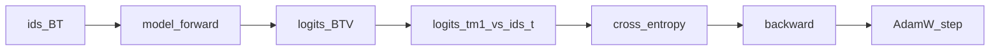

## Idea

**What:** *Causal language modeling* / **next-token pretraining** — given tokens to the left, score every vocab id as “what comes next,” then train so the true next id gets high probability.

**Why it matters:** This single self-supervised objective is what **writes** embedding rows and almost all trunk weights. Without it you have a random shell (or you load someone else’s floats, like the Llama example later).

**How (one line):** tokenize text → embed → forward → **shift** so position `t` predicts id `t+1` → cross-entropy → backward → optimizer step. Repeat on huge corpora.

Industry names the same thing: nanoGPT’s `X,Y` windows, Hugging Face “causal LM”, Llama 3 / DeepSeek “pretrain then align.”

### 1. What — the objective

For a token sequence \(x_1,\ldots,x_T\):

\[
p(x_1,\ldots,x_T)=\prod_t p(x_t \mid x_{<t})
\]

Training minimizes average **negative log-likelihood** = token-level **cross-entropy**. Labels come from the text itself (self-supervised)—no human “answer” column.

| Name | Meaning |
| --- | --- |
| **logits** | Raw scores `(batch, time, V)` before softmax |
| **next-token CE** | At each time, punish low probability on the true next id |
| **causal** | Position `t` must not see tokens after `t` (mask / decoder stack) |

### 2. Why — why this design

| Choice | Why |
| --- | --- |
| Predict **next** id | Turns any raw text into infinite training signal |
| One forward → many positions | Length-`T` sequence yields ~`T-1` supervised guesses (causal mask makes each legal) |
| CE on vocab | Matches “pick a discrete token”; differentiable via softmax |
| Update **embeds + all bricks** | Embedding chapter’s floats are not hand-filled—they move here |
| Pretrain **before** SFT/DPO | Align steers an already next-token-capable net; it does not invent the base skill |

Inference vs training:

| | Inference | Training (this chapter) |
| --- | --- | --- |
| True next id | Unknown | Known from the batch |
| After logits | sample / argmax | CE vs true id |
| Weights | usually frozen | updated every step |

### 3. How — shift, loss, one step (real code)

Tiny example ids `[10, 20, 30]` (“The cat sat” style, fake ids):

| Position | Sees (conceptually) | Must predict |
| --- | --- | --- |
| 0 | `10` | `20` |
| 1 | `10,20` | `30` |

**Implementation in this repo** ([`arche/train/pretrain.py`](https://github.com/chaxus/arche/blob/main/arche/train/pretrain.py)):

```python
def lm_loss(logits: torch.Tensor, targets: torch.Tensor) -> torch.Tensor:
    """Predict token t+1 from positions 0..T-1."""
    return F.cross_entropy(
        logits[:, :-1].reshape(-1, logits.size(-1)),  # drop last time
        targets[:, 1:].reshape(-1),                   # drop first id
    )
```

Same batch tensor is both input and label source: logits at `t` align with `targets[t+1]`.

Full micro-step:

```python
opt.zero_grad(set_to_none=True)
logits, _ = model(batch)       # (B, T, V)
loss = lm_loss(logits, batch)
loss.backward()
opt.step()
```

Lab driver ([`chapters/02-training/ep18_pretrain.py`](https://github.com/chaxus/arche/blob/main/chapters/02-training/ep18_pretrain.py)): tiny `Llama` + random id batches + `train_pretrain_steps` → print loss start→end.

**HF pitfall:** `DataCollatorForLanguageModeling(mlm=False)` often sets `labels = input_ids` **unshifted**; Transformers CausalLM shifts **inside** `forward`. Hand-written loops (ours / nanoGPT) shift explicitly. **Do not shift twice.**



Sanity: at random init, loss ≈ `log(V)` (uniform over vocab).

### 4. What “good” means

| Kind | Check |
| --- | --- |
| **Hard** | Shift is one token; causal (no future leak) |
| **Hard** | Grads reach embed rows + trunk; no NaN |
| **Soft** | Loss falls; samples less nonsense |
| **Soft** | Matches published recipe at scale (later chapters) |

### 5. Improve · whole-model impact

| Lever | Impact |
| --- | --- |
| More / better tokens | Main capability ceiling |
| Correct shift / mask | Silent wrong objective if broken |
| LR / clip / accum | Finishability (next chapter) |
| Under-train | Weak embeds **and** deep layers |

Next lessons split **data windows**, **optimizers**, and **frontier scale recipes** so this chapter stays the objective + one step.

### 6. Industry pointers

- Raschka FAQ: constructing input/target windows  
- nanoGPT `train.py`: readable full loop  
- HF LLM Course ch7.6: causal LM from scratch  
- Llama 3 / DeepSeek reports: same family of objective, different scale & architecture  

### 7. This course

```bash
python chapters/02-training/ep18_pretrain.py
```

Page playground: drag lr / steps. Forward stack details come in RMSNorm→… after the data/optim primers.

## Run

```bash
python chapters/02-training/ep18_pretrain.py
```

## Next

**Pretrain data** (`/pretrain-data/`): how batches and sliding windows are built.
