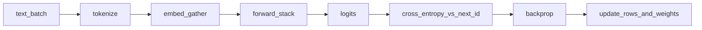

## Idea

This is the **core of from-zero**: **next-token training** (pretrain). It is how embedding rows and almost all trunk weights stop being random. Without it you only have a shell—or you load someone else’s finished floats (the Llama example later).

### 1. What it is for

On huge text, force the model to **guess the next id** given the previous ones. Wrong guesses → loss → backprop → rewrite parameters (including embeddings). That is the main author of the numbers you looked up in the embedding chapter.

### 2. Inference guess vs training guess

| | **Inference** (chat) | **Training** (this chapter) |
| --- | --- | --- |
| True next token | Unknown—you pick from scores | **Known** from the dataset |
| After scores | argmax / sample → append | Compare to the true id → **loss** |
| Parameters | Frozen (usually) | **Updated** every step |

Same forward shape; training adds the teacher signal and the rewrite.

### 3. From zero: the loop (plain steps)

Tiny sentence after tokenize, say ids `[10, 20, 30]` for `The cat sat` (fake ids):

| Position | Context ids | True next id |
| --- | --- | --- |
| 0 | `[10]` | `20` (`cat`) |
| 1 | `[10, 20]` | `30` (`sat`) |

What one train step does:

1. **Batch text** → tokenizer → id tensor  
2. **Embed** = gather float rows for those ids  
3. **Forward** through the stack → **logits** shape roughly `(batch, time, V)` — a score per vocab id at each position  
4. **Shift**: at position `t` predict id at `t+1` (never “cheat” with the answer in the input for that slot)  
5. **Loss** = cross-entropy between logits and the true next ids (average over positions)  
6. **Backward** = gradients flow into every used embed row and every brick weight  
7. **Optimizer** (e.g. AdamW) takes a small step; repeat for billions of tokens in real runs  



Init embeds are random lockers; **this loop writes the useful numbers.** Later chapters hand-write RMSNorm / RoPE / … so the forward in step 3 is *your* stack—not a mystery box.

### 4. What “good” means

| Kind | Check |
| --- | --- |
| **Hard** | Objective is really next-token; shift is correct; grads hit embeds + trunk |
| **Hard** | No NaN; loss defined on the right positions |
| **Soft** | Loss trends down; probes / samples get less nonsense |
| **Soft** | Stable lr / grad clip so a long run can finish |

### 5. Improve · whole-model impact

| Lever | Impact |
| --- | --- |
| Data mix & quality | Main ceiling of capability |
| Scale (params × tokens) | Scaling laws |
| Stability (norm, lr, clip) | Whether you finish at all |
| Under-train | Weak embeds **and** deep layers |

SFT / DPO (next part) steer an already next-token-capable net; they do not replace this base loop.

### 6. Industry · open models

Llama / Qwen / DeepSeek all tell a **pretrain → then align** story. Real stacks: Megatron / DeepSpeed / torchtitan-style. This lesson is a **toy API + playground**—feel the shape, not a cluster run.

### 7. This course

```bash
python chapters/02-training/ep18_pretrain.py
```

Use the page playground to drag lr / steps. Then go build the bricks that sit between embed and logits.

## Run

```bash
python chapters/02-training/ep18_pretrain.py
```

## Next

**RMSNorm** (`/rmsnorm/`): steady scales after embedding so deep next-token training can survive.
