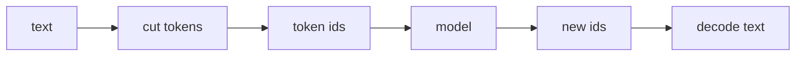

## Idea

### 1. What the tokenizer table is for

The tokenizer table (vocab + merge/cut rules) does two jobs:

1. **Cut** — text → pieces (**tokens**)  
2. **Number** — pieces → fixed integer **token ids**

Encode before the model; decode with the **same** table after. Specials (BOS/EOS/…) are fixed ids in that table.



One line: **one rule set for text ↔ ids.**

### 2. Why the LLM pipeline needs it

Models compute on numbers. Whole-sentence symbols explode the vocab; raw bytes make sequences too long. Tokenization is the stable, reversible middle. Without a tokenizer table, the **embedding table** has no row indices to pair with.

### 3. How the tokenizer table is generated

Open decoders mostly use **byte-level BPE** (Llama / much of the GPT line). **Not** hand-numbered words.

| Step | What happens |
| --- | --- |
| **1. Corpus** | Lots of text (what becomes frequent) |
| **2. Base vocab** | UTF-8 **256 bytes** (or equivalent) |
| **3. Merge loop** | Count adjacent pairs; merge the most frequent; append to merges |
| **4. Stop** | Hit target size (e.g. ~128K); add specials |
| **5. Save** | `tokenizer.json` / merges + specials; ship with the model |
| **6. You use it** | **Load the official table**; retrain only if you train a model from scratch |

Vs embeddings: the tokenizer comes from a **BPE-style algorithm on text**; the embedding table comes from **neural training** (next chapter).

The page playground uses **fixed teaching merges**. The script below **trains** a tiny table on a toy corpus.

### 4. Code: generate · use · measure

Teaching code: `arche/teach_bpe.py` (minimal byte BPE). Core loop:

```python
# Same idea as arche.teach_bpe.train_bpe
vocab = [bytes([i]) for i in range(256)]
merges = []
for _ in range(num_merges):
    a, b = most_frequent_adjacent_pair(corpus)
    merges.append((a, b))
    vocab.append(a + b)
    corpus = apply_merge(corpus, a, b)
```

Encode: bytes → apply merges in order → ids. Decode: ids → bytes → UTF-8.

Train a toy table (**no** Hugging Face):

```bash
python chapters/01-inference/ep02_teach_bpe.py
```

Expect `vocab_size`, ids, round-trip decode, rough `fertility≈`.

Then the **official Llama 3.2 table** (paired with weights; needs license):

```python
from arche.tokenizer import load_tokenizer
tok = load_tokenizer()
ids = tok.encode("The cat sat on the mat.")
text = tok.decode(ids)
```

```bash
huggingface-cli login
python chapters/01-inference/ep02_tokenizer.py
```

### 5. What “good” means

| Check | Plain meaning | How to see it |
| --- | --- | --- |
| **Reversible** | encode→decode recovers text (modulo normalizations) | Compare decode in scripts |
| **Compression / fertility** | Fewer tokens is cheaper; fertility = pieces per word (**higher = more fragmented**) | Toy script prints it; compare parallel corpora on official tables |
| **Parity** | Similar meaning across languages shouldn’t explode length | Parallel token counts |
| **Structure** | Don’t wreck code, URLs, numbers | Spot checks |
| **Checkpoint pairing** | id `i` must match embedding row `i` | **Hard**; foreign tables break models |
| **Vocab size** | Bigger often shorter sequences but fatter embeddings | Product tradeoff |
| **Downstream** | Final judge includes trained model quality | One main referee |

Pairing: train saw `the`→`65`→row 65; another table maps `the`→`902` → wrong row.

| When tables differ | Example |
| --- | --- |
| Model family | Llama ≠ Qwen ≠ `cl100k` |
| Generation bump | GPT-3.5 ~100K → GPT-4o ~200K |
| Train from scratch | New BPE; old embeds don’t fit |
| New specials | Append ids |
| Ops mistake | Llama weights + foreign `tokenizer.json` |

### 6. What labs ship · what we do

| Line | ~vocab | Note |
| --- | --- | --- |
| GPT tiktoken | 100K–200K | BPE |
| Llama 3.2 | 128K+ | **Course official table** |
| DeepSeek / Qwen / Kimi | ~128K–163K | Same family of ideas |

Toy training shows **generation**; official table shows **pairing**. Never mix them.

## Run

```bash
python chapters/01-inference/ep02_teach_bpe.py

huggingface-cli login
python chapters/01-inference/ep02_tokenizer.py
```

Optional: `export HF_ENDPOINT=https://hf-mirror.com`

## Fix

Official table: license / login / `401` / slow download. Teaching BPE needs no network.

## Next

**Embedding** (`?c=embedding`): after ids, how the embedding table is built, looked up, and judged.
