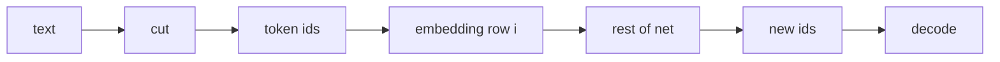

## Idea

This course aims to **build from zero toward frontier-ready**. The tokenizer table is not a disposable download—it is the first table you **choose or train** when you train a model; embeddings, pretraining, and inference cost all bind to it.

### 1. What the tokenizer table is for

Tokenizer table = **cut rules + vocab (piece ↔ id)**.

1. **Cut** — text → tokens  
2. **Number** — tokens → fixed integer ids  

Encode before the model; decode with the **same** table. Specials (BOS/EOS/tools) are ids too.



No table ⇒ embedding has no row indices; next-token pretraining has no vocab.

### 2. From zero: how you generate the table

Open decoders mostly use **byte-level BPE** (GPT/Llama family). From-scratch order:

| Step | What you do | What it fixes |
| --- | --- | --- |
| **1. Corpus mix** | code / EN / CJK / math / web… | which pieces enter the vocab; which languages compress |
| **2. Pretokenizer regex** | spaces, digits, punct, CJK | structure; Chinese UX |
| **3. Base symbols** | UTF-8 **256 bytes** | universal coverage, reversible |
| **4. BPE merges** | merge most frequent adjacent pairs to target size | compression |
| **5. Specials** | BOS/EOS/pad/tool marks | chat/agent protocols |
| **6. Freeze + version** | write `tokenizer.json` / merges | embedding rows & checkpoints lock to this id space |
| **7. Then embed + pretrain** | set `vocab_size`, build embedding, train | **changing the table ≈ rebuild embeds + heavy retrain** |

This course (same path):

- **How a table is grown:** `arche/teach_bpe.py` trains a tiny table so you see generation  
- **The Llama example’s finished table:** official Llama 3.2 tokenizer paired with its weights

### 3. What counts as a good table

**Hard constraints**

| Check | Plain meaning |
| --- | --- |
| **Reversible** | encode→decode recovers normal text |
| **Coverage** | any byte string representable |
| **Stable** | same text → same ids |
| **Train-time identity** | same table for pretrain/finetune/infer |

**Optimization targets**

| Check | Plain meaning | Impact on the whole model |
| --- | --- | --- |
| **Compression / fertility** | fewer tokens better; fertility = pieces/word | longer effective context; cheaper train/infer |
| **Parity** | similar meaning shouldn’t explode across languages | unfair ⇒ short effective context, expensive, undertrained |
| **Domain fit** | code/math/CJK not shredded | vertical ceiling |
| **Structure** | indent, JSON, URLs, numbers | tools & code |
| **Vocab size** | often 32K–200K+ | shorter seqs vs **embed params ∝ V×D** and fatter softmax |
| **Special design** | clear chat/tool boundaries | alignment & agents |
| **Downstream** | loss/evals under same trunk | one final referee |

“Good” is a tradeoff among compression, parity, size, and downstream—not one score.

### 4. How to improve · impact on the whole LLM

| Lever | How | Whole-model impact |
| --- | --- | --- |
| **Corpus mix** | more code/CJK/math | those domains compress & learn better; others may regress |
| **Pretokenizer** | digit/CJK-friendly regex | often beats blindly growing V |
| **Larger V** | more merges | shorter sequences; fatter embed/LM head; more VRAM |
| **Append specials** | grow table tail; keep old ids | **expand embedding rows** and keep training |
| **Change algorithm family** | BPE ↔ Unigram… | **new table**; rebuild embeds; retrain |
| **Extend inherited table** | append domain pieces | cheaper than full reset |

Frontier-from-zero practice: freeze tokenizer after data goals are clear → set `vocab_size` → embed → pretrain. Mid-flight table swaps are extremely expensive.

### 5. Industry · well-known open models

Most sit in **byte BPE / tiktoken-like** land; differences are corpus and regex, not “words vs characters” as the main split.

| Model / line | Engine & size | Notes |
| --- | --- | --- |
| **GPT-4 / 3.5** | tiktoken `cl100k` ~100K | open cut library; table bound to model |
| **GPT-4o** | `o200k` ~200K | generation bump; **new table ≠ old embeds** |
| **Llama 3 / 3.2** | byte BPE 128K+ | **course example**; factory-paired with weights |
| **Qwen** | BPE ~150K-class | self-trained; multilingual + tool specials |
| **DeepSeek-V3** | byte BPE ~128K | pretok/corpus for multilingual compression |
| **Kimi K2** | tiktoken-like ~163K | Han-friendlier regex |
| **Legacy BERT** | WordPiece | encoder era; **not interchangeable** with decoder BPE |
| **Some multilingual** | Unigram + SentencePiece | still used; different rules |

Consensus: trainers ship one table with the recipe; users only load that checkpoint’s tokenizer; next gens often grow V and improve multilingual/code regex.

### 6. Code (this course)

```bash
python chapters/01-inference/ep02_teach_bpe.py
```

```python
from arche.tokenizer import load_tokenizer
tok = load_tokenizer()
ids = tok.encode("The cat sat on the mat.")
```

```bash
huggingface-cli login
python chapters/01-inference/ep02_tokenizer.py
```

## Run

```bash
python chapters/01-inference/ep02_teach_bpe.py
huggingface-cli login
python chapters/01-inference/ep02_tokenizer.py
```

Optional: `export HF_ENDPOINT=https://hf-mirror.com`

## Fix

Official table: license / login / mirror. Teaching BPE needs no network.

## Next

**Embedding** (`/embedding/`): after the vocab is frozen, how to build the embedding table from zero, judge it, improve it, and what open models do.
