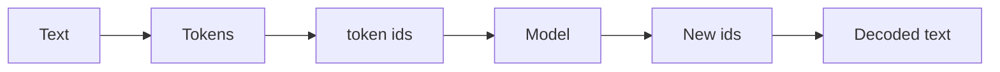
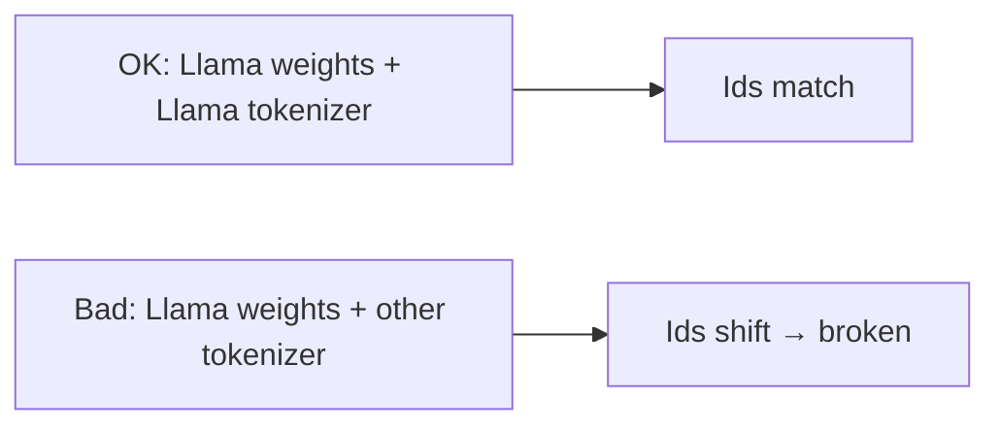

## Idea

### 1. Why tokenize

Models compute on numbers, not raw strings like “hello world”.

- One symbol per whole sentence → vocab explodes; unseen text breaks  
- Pure bytes only → sequences too long (slow, burns context)  

**Tokenization** is the middle ground: stable, learnable, length-controlled.  
One line: **same rules encode in and decode out.**

### 2. What a tokenizer does

1. **Split** — text → small chunks (**tokens**)  
2. **Number** — fixed vocab → **token ids** (ints)  

Everything downstream uses ids; generation ends by decoding with the **same** table. Specials (bos/eos/…) are fixed ids too.



Panel above: **teaching BPE** (intuition). Lab below: **official Llama 3.2** table.

### 3. Common cuts, and three names

| Cut | Plain idea | Today |
| --- | --- | --- |
| Word / whitespace | Spaces; CJK needs help | Rare as the main LLM scheme |
| Char / byte | One id per char/byte | Safety floor; pure use is too long |
| **BPE** | Merge frequent adjacent pieces | **Mainstream open decoders** |
| **WordPiece** | Subword, different merge rule | BERT-era |
| **Unigram** (often via **SentencePiece**) | Shrink a large candidate vocab | Still used in some stacks |

**BPE:** start from bytes/chars; merge the most frequent adjacent pair; repeat. Common chunks become their own tokens (`the`, `ing`).

**WordPiece:** also subword, but merges lean on likelihood, not raw counts. Looks like BPE; **different rule — don’t mix tables.**

**Unigram / SentencePiece:** Unigram = train-by-pruning objective; SentencePiece ≈ **toolkit** (often cuts raw text—handy for CJK). “SentencePiece tokenizer” usually means Unigram (or BPE) trained with that tool.

All three are **subwords**. Product gaps more often come from **data, pretokenizer regex, vocab size**.

### 4. What labs actually ship

| Family | Engine | ~Vocab | Note |
| --- | --- | --- | --- |
| GPT-4 / 3.5 | tiktoken BPE `cl100k` | ~100K | Encoding open |
| GPT-4o / o | tiktoken BPE `o200k` | ~200K | Larger; often fewer non-English tokens |
| Llama 3 / 3.2 | byte BPE | 128K+ | **This course** |
| DeepSeek-V3 | byte BPE | ~128K | Pretokenizer/data for multilingual compression |
| Kimi K2 | tiktoken-style BPE | ~163K | Han-aware regex |
| Qwen, … | BPE | ~150K | Same road; own merges |

Takeaway: everyone iterates **inside byte-level BPE / tiktoken-family**.

### 5. What “good” means (and what “weights” are)

| Criterion | Plain meaning |
| --- | --- |
| **Compression / fertility** | Tokens for the same text; fewer is tighter. Fertility = tokens per word; **higher = more fragmented** |
| **Parity** | Similar token counts across languages for the same meaning |
| **Structure** | Don’t shatter indent, newlines, URLs, digits |
| **Paired with the checkpoint** | Hard rule — see example |
| **Vocab size / speed / reversible / specials / downstream** | Bigger often shorter but fatter embeddings; must be fast and lossless; final judge is trained quality |

**“Must pair with the same weights” — and why you usually don’t swap cuts:**

Next chapter: each id looks up **one row** in the **embedding table** (part of the **weights**).  
Normal use is already: **however you split is how you look up** — one checkpoint ships with one tokenizer; you don’t casually change mid-flight.

So why stress mismatches? Because **many tables exist**; breakage is usually a **wrong pair**, not changing your mind mid-request:

| When tables differ | Example |
| --- | --- |
| **Different model families** | Llama ≠ Qwen ≠ GPT `cl100k` / `o200k` |
| **Same vendor, new generation** | GPT-3.5 ~100K → GPT-4o ~200K (retrain/expand) |
| **Train from scratch** | New BPE on your corpus; old table won’t fit new embeddings |
| **Added specials** | Finetune/tools append markers; merges often unchanged, id space grows |
| **Ops mistake** | Llama weights + someone else’s `tokenizer.json` |

So:

- **Using one model:** split and look up with its table; no random swaps.  
- **Why we teach pairing:** avoid “these weights + that family’s tokenizer”; also why vendors differ and generations expand vocabs.  

Example: train-time `the` → **65** → row 65 means “the”. Wrong table maps `the` → **902** → model still reads row 902 → nonsense.



Papers: compression/parity help, not enough alone.

### 6. What we do here

Official **Llama 3.2** BPE (`128256`) — not because we might swap tables, but because **loading these weights only works with this table**. The teaching panel is intuition only.

## Run

Accept `meta-llama/Llama-3.2-1B` on Hugging Face, then:

```bash
huggingface-cli login
python chapters/01-inference/ep02_tokenizer.py
```

Expect ids, round-trip decode, bos / eos / pad. Mirror: `export HF_ENDPOINT=https://hf-mirror.com`

## Fix

Gated download—open when stuck:

- No license / login → script hints  
- `401` → Agree, then login again  
- Slow → HF mirror  

## Next

**Embedding** (`?c=embedding`): how an id becomes that row of numbers.
